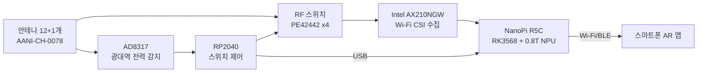

# DeteCam 6.0 (`Nano-2 AI`) 최종 종합 보고서

**작성일**: 2026년 11월 24일 · **최종 확정안**: `DeteCam 6.0 Nano-2 AI` (방안 3 — 커스텀 RF PCB는 JLCPCB PCBA 웹 주문, 나머지는 기성품 무납땜 조립)
**관련 문서**: [주제 설명서](주제_설명서.md) · [구매 부품 목록](구매_부품_목록.md) · [기술검증 보고서](기술검증_보고서.md) · [발표 슬라이드 가이드](발표_슬라이드_가이드.md)

> [!NOTE]
> 모든 수치는 출처를 구분해 표기합니다: `[시뮬레이션]` 3D 전자기 광선추적, `[AI 실학습]` PyTorch 학습·미학습 공간 평가, `[CAD]` 기계 간섭 검증, `[실측]` Bambu Studio 2.9.1 슬라이싱. **실물 하드웨어 측정값은 아직 없습니다**(11절 참고).

---

## 1. 한 장 요약

| 항목 | v4.0 (`Fold12_36cm`) | v5.0 (`Palm-12`) | **v6.0 최종 (`Nano-2 AI`)** |
|---|---|---|---|
| 수신기 개수 | 3기 + 스탠드 | 3기 벽부착 | **2기 벽부착 (스탠드 없음)** |
| 1기 크기 | 420 × 420 × 110 mm | 120 × 120 × 29.6 mm | **96 × 96 × 36 mm (손바닥 크기)** |
| 1기 무게 | ~1.6 kg | ~215 g | **219.9 g** |
| 2기(3기) 총 부품비 (100% 신품) | ~84만 원 | ~46.7만 원 | **~34.6만 원 (Global Sourcing 수수료 포함 시 최대 ~38만 원)** |
| 5.22 GHz 10공간 오차 P90 | 그레이팅 로브 취약 | 0.84 m | **0.54 m** |
| 처음 보는 공간(미학습 4개) P90 | — | 1.86 m | **0.64 m** |
| 소프트웨어/AI 비중 | 규칙 기반 | 고전 신호처리 | **PyTorch AI 4종 + 물리 결합 모델** |

**핵심 메시지**: 하드웨어는 줄였고(3기→2기, 42 cm→9.6 cm, 84만→34.6만 원) 빠진 정확도는 **AI와 물리 모델**로 채웠습니다. 그 결과 2기만으로 기존 3기 구성보다 오차가 작습니다.

---

## 2. 교수님 지적 사항과 대응

| 지적 | 대응 | 근거 |
|---|---|---|
| ① 수많은 전자기기 중 카메라만 어떻게 찾나? | `CamGuard-Net`(트래픽 패턴 AI) + **5초 불 끄기/손 흔들기 자극(`CamLoPA`)** 으로 영상 인코더 반응을 확인 | F1 **98.88%**, 오경보 **1.25%** `[AI 실학습 · 800대]` |
| ② 전파가 반사·간섭하는데 위치를 어떻게 찾나? | 그레이팅 로브 없는 84 mm 배열 + `ReconCovNet-v4` 초해상도 + **반사를 가상 거울 앵커로 활용(`MA-PINN`)** | 사각지대(NLoS) P90 **1.90 → 0.63 m** `[시뮬레이션]` |
| ③ 공간마다 구조가 다른데 실제로 최적 위치를 어떻게 찾나? | **`AR-OPA-2`**: 스마트폰으로 방을 5초 스캔 → 2개 벽면 위치·각도를 AR로 표시 → 3초 자동 검증 | 10종 공간 560회 평가 `[시뮬레이션]` |
| ④ 너무 하드웨어 중심이다 | 하드웨어를 최소화하고 핵심 성능을 **AI 4종**으로 전환 | 4.3절 |

---

## 3. 최종 시스템 구조

### 3.1 하드웨어 (1기 기준, 2기 사용)

| 구성 | 부품 | 역할 |
|---|---|---|
| 안테나 배열 | `84 × 84 mm` 4층 RF PCB 테두리에 칩 안테나 12개 + 기준 1개 | 전파가 각 안테나에 도착하는 시간차(위상차) 측정 |
| 안테나 전환 | `PE42442` SP4T 스위치 4개 (`30 MHz–6 GHz`) | 12개 안테나를 AX210 2개 포트에 순서대로 연결 |
| 수신 칩 | `Intel AX210NGW` (PCIe, 2×2 MIMO) | Wi-Fi 패킷에서 CSI(위상·세기 정보) 추출 |
| 컴퓨터 | `FriendlyElec NanoPi R5C` 4GB/32GB | AI 추론, 위치 계산, 앱 통신 |
| 보조 | `AD8317` 전력 감지기, `RP2040` MCU | 비 Wi-Fi 신호 감지, 6 ms 안테나 스캔 제어 |
| 케이스 | PLA 3D 프린팅 7부품 + 자석·나노겔 벽 부착 + 2축 스위블 | Pan `±30°`, Tilt `0°/-15°/-25°` |

### 3.2 소프트웨어 스택 (실물 구동 기준)

| 계층 | 선택 | 이유 |
|---|---|---|
| OS | **Armbian Mainline (Linux 6.8–6.12 + `linux-headers`)** | `iwlwifi` AX210 드라이버 정식 지원 |
| CSI 수집 | **`VesperCSI`** (GPL-3.0, ARM64 지원) | `PicoScenes`는 ARM64 미지원, `FeitCSI`는 버스트 보존율 44–46%로 낮음 |
| AI 추론 | PyTorch → RK3568 NPU / CPU | 모든 모델이 CPU만으로도 1 ms 미만 |
| 앱 | 스마트폰 AR (ARKit/ARCore) | 방 구조 스캔 + 설치 위치 안내 + 결과 표시 |

> [!IMPORTANT]
> **반드시 `AX210NGW`** 를 써야 합니다. `AX201`/`AX211`은 인텔 노트북 전용 CNVio2 규격이라 NanoPi R5C에서 인식되지 않습니다.

---

## 4. 소프트웨어·AI 엔진 (하드웨어 의존도를 낮춘 핵심)

| 엔진 | 하는 일 (쉬운 설명) | 크기 / 속도 | 검증 결과 |
|---|---|---|---|
| **`ReconCovNet-v4`** | 작은 안테나 배열 때문에 흐려진 "방향 사진"을 선명하게 복원하는 AI 돋보기 | 457,112 파라미터 / 0.024 ms | 미학습 공간 P90 각도오차 2.45 GHz **-16.8%**, 5.22 GHz **-11.1%** |
| **`CamGuard-Net`** | 패킷 크기·간격 패턴 + 5초 자극 반응으로 "카메라인지" 판별 | 29,122 파라미터 / 0.124 ms | F1 **98.88%**, 재현율 99.00%, 오경보 1.25% |
| **`MA-PINN`** (Bayesian) | 벽·거울 반사를 "가상 수신기"로 바꿔 사각지대 해결 | 물리 결합 모델 | NLoS P90 3기 대비 **-67%** |
| **`AR-OPA-2` + `RAPS`** | 방 스캔으로 최적 설치 위치 2곳 계산 + 신뢰 구간(90%) 표시 | 0.1초 계산 | 1기만 쓰면 P90 3.06 m → 2기 0.54 m (2기가 최적점) |

학습 데이터는 공간 1–6번, 평가는 **한 번도 보지 않은 공간 7–10번**(강의실·강당·유리 사무실·짐 많은 기숙사)으로 분리해 과적합을 배제했습니다.

---

## 5. 위치 정확도 상세 `[시뮬레이션 · 10개 공간 560회]`

### 5.1 전체 결과 (오차 중앙값 / P90 / 1 m 이내 비율)

| 구간 | 대역 | v5.0 3기 | **v6.0 2기 AI** | 2기 AI + 폰 보행(0원) |
|---|---|---:|---:|---:|
| 전체 10공간 | 5.22 GHz | 0.20 / 0.84 m / 90.7% | **0.19 / 0.54 m / 96.4%** | 0.19 / 0.50 m / 98.2% |
| 미학습 4공간 | 5.22 GHz | 0.24 / 1.86 m / 84.8% | **0.21 / 0.64 m / 95.5%** | 0.21 / 0.62 m / 96.4% |
| 사각지대 NLoS | 5.22 GHz | 0.21 / 1.90 m / 86.3% | **0.22 / 0.63 m / 95.1%** | 0.21 / 0.62 m / 97.1% |
| 전체 10공간 | 2.45 GHz | 0.20 / 0.61 m / 94.3% | **0.24 / 0.87 m / 92.9%** | 0.23 / 0.65 m / 96.4% |
| 사각지대 NLoS | 2.45 GHz | 0.22 / 1.34 m / 87.3% | **0.30 / 1.06 m / 87.3%** | 0.25 / 0.80 m / 96.1% |

### 5.2 "오차 1 m"의 의미 — 각도 오차로 환산

두 수신기가 가리키는 두 직선이 만나는 곳을 AR로 표시합니다. 각도가 조금만 틀어져도 거리가 멀면 교차점이 밀립니다(거리 5 m에서 1° ≈ 8.7 cm).

| 대역 | 단일 수신기 직선 시야(LoS) 각도오차 중앙값 | 2기 교차 3D 오차 중앙값 | 비고 |
|---|---|---|---|
| 5.22 GHz | **1.19°–1.90°** (강당 2.76°) | **14–23 cm** (강당 45 cm) | 파장이 짧아 더 정확 |
| 2.45 GHz | **2.19°–3.85°** (강당 4.51°) | **14–25 cm** (강의실 43 cm, 강당 82 cm) | 파장이 길어 빔이 넓음 → AI 보정 효과 큼 |

**P90 0.5–1 m**는 "10번 중 9번은 이 거리 안"이라는 최악 쪽 지표이며, 주로 반사가 심한 사각지대나 150석 강당에서 발생합니다.

---

## 6. 현장 설치 방법 (`AR-OPA-2`)

1. 스마트폰으로 방을 5초 스캔 → 벽·거울·사물함·칸막이 자동 인식
2. 앱이 직선 시야 + 반사 시야를 계산해 **벽면 2곳과 스위블 각도**를 AR로 표시
3. 자석/나노겔로 부착 후 **3초 상호 교정**(두 수신기가 서로 신호를 주고받아 숨은 철근·배관 반사 점검)
4. 5초 불 끄기/손 흔들기 → 카메라 판별 + 위치를 AR 원으로 표시

자세한 공간별 배치 규칙: [`receiver/docs/현장_최적배치_가이드.md`](https://github.com/DeteCam/receiver/blob/main/docs/현장_최적배치_가이드.md)

---

## 7. 제작 방식 결정 (방안 3 확정)

| 방안 | 외주 | 크기 | 비용(2기) | 0.03초 단발 카메라 | 소음 | 결정 |
|---|---|---|---|---|---|---|
| 1. 회전 원판 합성개구 | 없음 | 96 × 96 × 46 mm | ~27만 원 | 2~3장 누적 필요 | 미세 모터음 | 보류 |
| 2. 기성 RF 스위치 모듈 | 없음 | ~120 mm | ~42–50만 원 | 가능 | 무소음 | 보류 |
| **3. JLCPCB PCBA (현재 설계)** | **웹 주문 (파일 업로드)** | **96 × 96 × 36 mm** | **~34.6–38만 원** | **즉시 탐지 (6 ms 스캔)** | **무소음** | **✅ 확정** |

- 직접 납땜은 **0회**입니다. PCB 위 초소형 칩은 JLCPCB가 정품 조달(`Global Sourcing`) 후 실장해서 보내줍니다.
- 나머지(NanoPi R5C, AX210, 케이블, 자석, 볼트)는 알리익스프레스·쿠팡에서 사서 **끼우고 볼트만 조이면 됩니다**.

---

## 8. 3D 프린팅·조립 `[CAD]` `[실측]`

- **노드 1기 = 1판**: `print/gcode/1판_포켓노드_1기전체.gcode.3mf` — **4시간 00분, PLA 124.9 g, 7부품, 서포트 0**
- 2기 전체: 2판, 8시간, 249.8 g
- 9개 극한 각도(Pan × Tilt)에서 부품 겹침·벽 충돌 **0.0 mm³**
- 조립 4단계(무공구 + 볼트): AI 엣지부 → RF PCB·차폐 → 벽 마운트 → 스위블 체결
- 영상: `receiver/docs/videos/조립_시뮬레이션.mp4`, `배치_동작_시뮬레이션.mp4`

---

## 9. 부품 조달 요약

| 구매처 | 품목 |
|---|---|
| 알리익스프레스 / FriendlyElec 공식몰 | NanoPi R5C 4GB/32GB × 2 |
| 알리익스프레스 / 쿠팡 | Intel **AX210NGW** × 2, MHF4 케이블, Ni-Cu 차폐 테이프 |
| JLCPCB (웹 주문) | 84 × 84 mm 4층 RF PCB + 부품 실장 × 2 (`PE42442`, `AD8317`, `AANI-CH-0078`은 Global Sourcing, `RP2040`=`C2040`) |
| 쿠팡 / 국내몰 | 자석, 나노겔, 볼트, USB-C 케이블, 보조배터리, PLA |

상세 단가·함정 부품 경고: [구매_부품_목록.md](구매_부품_목록.md)

---

## 10. 저장소 정리 결과

| 저장소 | 내용 | 상태 |
|---|---|---|
| `DeteCam/receiver` | CAD·STL·G-code, 시뮬레이션, AI 학습, 펌웨어, 테스트(6/6) | 최신 v6만 유지 |
| `DeteCam/docs` | 주제 설명서, 부품 목록, 기술검증·종합 보고서, 발표자료 | 최신 v6만 유지 |
| `DeteCam/ai` | AI 모델 설명·가중치 연동 | 최신 v6 |
| `DeteCam/app` | AR 앱 설계 | 최신 v6 |
| `DeteCam/.github` | 조직 프로필, CI(commit-lint) | 최신 |
| `DeteCam/receiver-legacy` | 과거 버전 보관 | **수정하지 않음** |

---

## 11. 정직한 한계와 남은 작업

### 기술적 한계
- Wi-Fi를 송출하지 않는 **SD카드 저장형·전원 꺼진 카메라**는 탐지 불가 → 렌즈 반사/열화상 병행 권장
- 150석 강당 P90 **2.06 m**(폰 보행 결합 시 1.04 m) → 필요 시 3기 확장
- 모든 정확도는 **시뮬레이션 값**이며 실물 측정으로 확인해야 함

### 남은 작업 (우선순위 순)
1. **KiCad RF PCB 아트워크 제작** → JLCPCB 업로드용 `Gerber.zip` / `BOM.csv` / `CPL.csv` 생성 (현재 저장소에 없음)
2. 1기 시제품 제작 → `VesperCSI`로 AX210 CSI 수집 및 위상 보정 확인
3. 실제 방 3곳 이상에서 시뮬레이션 대비 실측 오차 비교
4. Figma 발표 슬라이드 반영 (`docs/slides/DeteCam_6.0_발표자료.pptx` 기준)
