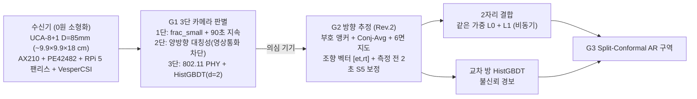

# SPEC-002+ Rev.2 검증 보고서 — 하드웨어 · 소프트웨어 · AI 구성 탐색 (2026-11-25)

> [!CAUTION]
> **시뮬레이션이며 실측 아님. 카메라 판별 숫자는 공개 데이터 사전 검증값이다.** ([AGENTS.md](AGENTS.md) 5.4 · 5.5 · 6.2 · 7.2절)
> 1. **방향 추정(Track B · C)의 모든 숫자는 `Sionna RT 2.2.0` + `nec2c 1.3.1` 시뮬레이션 계산값이다.** 논문 실측값(`DiffLoc+ 11.92°`)과 비교해 "목표 달성"이라 쓰지 않으며, **설계 선택과 V2 최소 구매 시험(3.5~5만 원)의 근거**로만 쓴다.
> 2. **카메라 판별(Track D)의 숫자는 실제 기기 공개 PCAP(UNSW IoT 2019 + Deakin IoT 2023)에서 IP/TCP/UDP/페이로드를 가린 L2 사전 검증값**이다. 영상통화 · 모바일 라이브 방송 · 2.4/5 GHz 분리 · 802.11 PHY 능력(`rateNflag`)이 없으므로, G1 합격은 **V5 AX210 모니터 모드 실측(2.4 · 5 GHz 각각)**으로만 판정한다.
> 3. **조사 방법 (6.2절)**: 작업 환경에 크롬 브라우저를 연결할 수 없어 1순위 대안인 웹 검색 · 웹 페이지 가져오기 도구로 1차 자료(논문 원문, 데이터시트, 공식 소스 코드 · 이슈 · 포럼)를 확인했다.

> [!WARNING]
> **재현 상태 (5.5절)**: 이 보고서의 표는 일회성 작업 환경에서 돌린 평가 스크립트(`v15_*`, `nec2_geoms*`, `g1_clean_lodo.py` 등)로 냈으며, **그 스크립트와 결과 파일은 저장소에 들어 있지 않다.** 저장소에 들어간 것은 그 결과를 바탕으로 한 코드 수정(receiver `estimators.py`의 `exact_manifold` · `tc_step_ns`, ai `public_lodo_baseline.py`의 Deakin SLL 파싱)뿐이다. 아래 숫자는 **재현 대기**이며, receiver `sim/`과 ai `eval/`에 평가 스크립트를 다시 넣어 같은 값을 낼 때까지 V2 이후 결정의 단독 근거로 쓰지 않는다(재현 과제: receiver `specs/002-switch-ring-receiver/tasks.md` T-R2).

---

## 0. 핵심 결론 — `SPEC-002+`에 대한 0원 업그레이드 5가지 (`SPEC-002+ Rev.2`)

무선 칩 · 스위치 · 호스트(`AX210NGW + PE42482 + RPi 5 팬리스 + VesperCSI`)를 대체할 더 나은 기성품은 찾지 못했다. 추가 비용 0원으로 아래 5가지를 바꾼다.

| 번호 | 구분 | 기존 `SPEC-002+` | **`Rev.2`** | 추가 비용 | 근거 (계산값 / 공개 PCAP 사전 검증) |
|---|---|---|---|---|---|
| ① | 안테나 고리 지름 | `UCA-8+1 D=100 mm` (외경 ~11.4 cm) | **`UCA-8+1 D=85 mm` 기본** (외경 ~9.9 cm) | 0원 (3D 프린트) | 평가 9장면: 2.4 GHz는 `D=100`과 비슷(대각 `7.67° vs 7.57°`), 5 GHz는 대각 평균 `-0.53°` · P95 `-3.2°` · 최악 방 `-1.2°`. NEC2 5 GHz 정합 `-11.2 → -14.0 dB` |
| ② | 조향 벡터 | `[et/rt, 1]` (기준 소자로 나눈 꼴을 반사 거울상마다 따로 씀) | **`[et, rt]`** (거울상 사이 상대 진폭을 보존) | 0원 | `D=85`에서 2.4 GHz 최악 금속방 `11.7° → 10.6°`, 대각 P95 `24.8° → 23.7°`; 5 GHz 대각 `7.45° → 7.18°`, 80 MHz P95 `23.5° → 20.6°` |
| ③ | 현장 보정 `S5` | 수동 배치 가정 (`σ_각도 5°`, `σ_위치 15 cm`) | **측정 시작 전 2초 폰/AR 앵커 보정 1회** (`σ_각도 1.5°`, `σ_위치 5 cm`; 측정 중 이동 없음 = R3) | 0원 | `D=85` 대각 2.4 GHz `6.81°`(P95 `22.6°`, 최악 금속방 `9.7°`), 5 GHz `6.29°`(P95 `21.1°`, 최악 방 `9.8°`) |
| ④ | 2자리 결합 · 신뢰도 · AR 구역 | `1/spread` 가중 결합 + 보정 안 한 Softmax 구역(방 면적 47%) | **결합은 같은 가중 `L0+L1`**, **불신뢰 경보는 교차 방 `HistGBDT`**, **AR 구역은 `Split-Conformal 90`** | 0원 | `오차>20°` 경보 AUC `spread 0.65 → HistGBDT 0.767(2.4G)/0.800(5G)`; 2D 구역 포함률 `93.2~94.7%`를 지키며 면적 `47% → 31~33%` |
| ⑤ | G1 판별 | Deakin SLL 파싱 오류 + `HistGBDT(d=3)` (교차 전이 재현율 49%) | **Deakin `DLT_LINUX_SLL` 중복 제거** + **3단: ① `frac_small` 규칙 + 90초 지속 → ② 양방향 대칭성 → ③ 802.11 PHY + `HistGBDT d=2`** | 0원 | 통합 LODO `96.8% / 오탐 0.7% / AUC 0.986` (기기 6/6, 오탐 기기 0/11); 교차 랩 `UNSW→Deakin` `94.4% / 1.6% / AUC 0.994` (3/3, 0/3). 영상통화 · 라방은 V5 실측 필수 |

---

## 1. Track A — 상용 칩셋 · 호스트 · 스위치 대안 조사 (V0 확장, 확인일 2026-11-25)

| 후보 | 2.4 + 5 GHz 비협조 모니터 CSI | R1~R9 점검 | 확인 수준 | 판정 · 출처 · 반대 증거 |
|---|---|---|---|---|
| **현재 `SPEC-002+` (`AX210NGW` + `PE42482` + RPi 5 팬리스 + `VesperCSI`)** | ○ (OFDM 11a/g/n/ac/ax 2-RX, 11b DSSS 불가) | 모두 충족 *(RX0/RX1 독립 AGC `미확인` → V2)* | `확인됨(문서)+(사례)` / AGC `미확인` | 유지. *Portner et al.* (`arXiv:2605.26836v1`, 2026-05): 상태 내 위상 SD `0.40°`, 5일 안정도 `0.99970`. *SniFi* (IEEE TMC 2026-09 Fig. 7): 분배기 직결에서 위상차가 정확히 π 두 상태로 바뀜 → 수동 부호 앵커 원리 지지 |
| MediaTek `mt76` (`MtkCSIdump` 2025-12, `OpenWrt One` MT7981B, `BPI-R3` MT7986) | ✗/미확인 (AP/STA 연결 필요) | R8 위반 (`OpenWrt One` 148 × 100.5 mm) | `확인됨(문서)+(사례)` | 탈락(비상 백업 #2 유지). `MtkWifiRev/MtkCSIdump`는 연결 기준, OpenWrt 포럼 `#244703`(2026-07): 80 MHz 연결에서도 CSI 20 MHz만 출력, MT7986 순정 펌웨어 `CSI_CTRL` 제거(2026-04). AX210 완전 실패 시 `AW7915`(\$30) 시험 |
| Qualcomm `ath10k/11k/12k` | ✗ | 공개 CSI 추출기 없음 | `확인됨(문서)` | 탈락. `xieyaxiongfly/Atheros_CSI_tool_OpenWRT_src#16`: `ath10k` 이후 펌웨어가 CSI를 내보내지 않음 |
| Broadcom `AX-CSI` (`RT-AX86U`) / `ZTECSITool` | △ (패처 비공개) | R8 · R2 · R9 · R6 위반 | `확인됨(문서)` | 탈락 |
| Intel `BE200` (Wi-Fi 7) | ✗ | `VesperCSI` · `FeitCSI` · `PicoScenes` 미지원 | `확인됨(문서)` | 탈락 (`arXiv:2610.22581v1` 지원 목록에 없음) |
| 호스트 대안 (N100 미니PC, CM4/5, Radxa/OrangePi) | — | N100 내장 팬(R1), GPIO 없음; 저가 SBC PCIe 없음 | `확인됨(문서)` | RPi 5 팬리스 + M.2 E-key HAT 유지 |

---

## 2. Track B — 0원 안테나 배치 8종 (`nec2c 1.3.1` → `Sionna RT 2.2`, 계산값)

개발 4장면(`classroom_a`, `lodging_a`, `restroom_a`, `locker_a`)에서 고르고, 고른 후보만 평가 9장면에서 확인했다.

| 배치 | 외경 × 높이 · RPi 5 수납 | NEC2 `S11` (2.4G / 5G, 고리·기준) | Dev 4 **2.4 GHz** `1자리 / 인접 / 대각` (P95) | Dev 4 **5 GHz** `1자리 / 인접 / 대각` (P95) | 판정 |
|---|---|---|---|---|---|
| 기준 `UCA-8+1 D=100 mm` | `11.4 × 18 cm` (○) | `-6.7/-3.8` · `-11.2/-5.7` dB | 9.9° / 8.0° / 8.2° (`25.6°`) | 9.9° / 8.8° / 9.2° (`34.6°`) | 2.4 GHz 1위 → 평가 |
| **`UCA-8+1 D=85 mm`** | **`9.9 × 18 cm` (○)** | `-6.8/-3.3` · **`-14.0/-8.2` dB** | 10.2° / 8.4° / 8.8° (`26.7°`) | **9.6° / 8.4° / 8.6° (`30.5°`)** | 5 GHz 1위 + 소형 → 평가 |
| `B4 Compact D=75 mm` | `8.9 × 18 cm` (✗ RPi 5 빡빡) | `-7.1/-3.1` · `-14.0/-18.8` dB | 10.5° / 8.5° / 8.8° (`25.6°`) | 10.4° / 8.6° / 9.1° (`31.1°`) | 초소형 비교용 → 평가 |
| `B1 Star (r=52/30)` | `11.4 × 18 cm` | `-7.0/-5.0` · `-15.7/-11.7` dB | 10.2° / 8.5° / 9.0° | 10.5° / 8.8° / 8.5° | 탈락: 안쪽 고리 상호결합 |
| `B2 Stagger3D (D=95, z=0/38)` | `10.5 × 19.3 cm` | `-10.6/-3.6` · `-11.7/-8.2` dB | 10.8° / 8.9° / 9.3° | 10.1° / 9.1° / 9.7° | 탈락: 높이 단차가 카메라 높이와 얽힘 |
| `B3 Spiral3D` | `11.0 × 19.0 cm` | `-9.7/-7.8` · `-10.9/-14.2` dB | 11.2° / 9.0° / 9.2° | 10.6° / 9.0° / 9.7° | 탈락 |
| `B5 ShieldedCan` (중앙 금속통) | `11.4 × 19.0 cm` | `-6.6/-17.2` · `-21.4/-11.8` dB (FBR +13.8 dB) | 12.1° / 10.0° / 10.2° | 10.9° / 9.6° / 9.5° | 탈락: NEC2 FBR만 좋고 실제 경로에서 반대편 소자 차폐로 `+2.2°` |
| `B6 Slant30` (±30° 이중편파) | `10.9 × 18 cm` | `-7.5/-5.8` · `-11.7/-7.8` dB | 11.0° / 10.2° / 9.5° | — | 탈락: 자유도 과다로 `+1.1°~2.2°` |

`D=85 mm`는 인접 SMA 중심 간격 `32.5 mm`(13 mm 안테나 밑동 사이 여유 `19.5 mm`), 외경 `~9.9 cm`로 RPi 5 팬리스 케이스(`8.8 × 6.0 cm`)를 담을 수 있다.

---

## 3. Track C — 방향 추정 SW/AI와 G3 AR 구역 (개발 4장면 → 평가 9장면, 계산값)

### 3.1 도구 · 설정 · 완화 조건
- `Sionna RT 2.2.0` (`Mitsuba 3.9.1`, `Dr.Jit 1.5.0`, `max_depth=4`, 회절 · 산란 · 투과, 원당 광선 100,000) + `nec2c 1.3.1-2` (구리, 50 Ω 흡수 종단, 2437 / 5220 MHz).
- 신호 생성(`gen_scenes.py`)과 추정기를 분리. 조절값 · 학습 모델 · Conformal 임계값은 개발 4장면에서만 정하고 평가 9장면(처음 보는 공간 `강의실 A/B` · `목욕탕 A/B` + 변형 B 4종 + `worst_metal`; 장면당 카메라 40 × 난수 3 × 자리 4 = 대역당 1자리 4,320회 / 2자리 쌍 2,160회)에서 평가.
- 현실 오차: 방 크기 · 수신기 위치 `σ=15 cm`, 각도 `σ=5°`(S5 보정 시 `5 cm / 1.5°`), 포트 위상 `4.5°`, 진폭 `0.4 dB`, `SNR=20 dB`, 비직접파 35% 사람 움직임 변동, 패킷당 π 반전 + 부호 앵커.
- **완화 조건**: ① 공진 반파장 다이폴 가정, ② AX210 독립 AGC 이득 단차 미포함(V2 확인).

### 3.2 평가 9장면 통합 (계산값)

**2.4 GHz (20 MHz)**

| 구성 (외경) | 1자리 (평균/중앙/P90/P95) | 인접 `(0,1)` | 대각 `(0,3)` | 최악 방 (대각 평균 / P95) | 최악 자리 | 부호 복원 |
|---|---|---|---|---|---|---|
| `BASE_D100_Conj` (11.4 cm) | 9.15 / 5.1 / 20.7 / 29.9° | 8.23 / 4.8 / 17.5 / 25.9° | 7.66 / 4.6 / 17.1 / 23.9° | `worst_metal` 10.6° (31.6°) | 자리1 10.0° | 98.93% |
| `EXACT_D100_MAP` (11.4 cm) | 8.97 / 5.1 / 20.3 / 29.3° | 8.23 / 4.8 / 17.6 / 25.7° | 7.57 / 4.5 / 16.6 / 23.1° | 10.3° (29.5°) | 9.8° | 98.93% |
| `BASE_D85_Conj` (9.9 cm) | 9.38 / 5.4 / 21.1 / 30.4° | 8.35 / 4.8 / 18.1 / 26.1° | 7.99 / 4.9 / 17.5 / 24.8° | 11.7° (35.7°) | 10.3° | 98.89% |
| **`EXACT_D85_MAP` (9.9 cm)** | 9.20 / 5.4 / 20.6 / 29.6° | 8.50 / 4.9 / 18.0 / 26.8° | **7.67 / 4.7 / 17.1 / 23.7°** | **10.6° (29.6°)** | 10.1° | 98.89% |
| `SMOOTHPR_D85_MAP` | 9.12 / 5.3 / 20.4 / 29.4° | 8.43 / 4.9 / 17.8 / 25.9° | 7.62 / 4.6 / 16.8 / 23.8° | 10.6° (29.6°) | 10.0° | 98.89% |
| `D75_EXACT_MAP` (8.9 cm) | 9.46 / 5.5 / 20.9 / 30.2° | 8.75 / 5.1 / 19.3 / 27.0° | 7.92 / 4.7 / 17.3 / 24.5° | 10.7° (30.7°) | 10.4° | 98.89% |
| **`S5CAL_D85_MAP` (9.9 cm)** | **8.28 / 4.4 / 19.5 / 28.3°** | **7.37 / 3.8 / 16.3 / 24.8°** | **6.81 / 3.9 / 15.8 / 22.6°** | **9.7° (29.6°)** | 9.0° | 98.89% |
| `S5CAL_D100_MAP` (11.4 cm) | 8.05 / 4.2 / 19.3 / 28.1° | 7.20 / 3.7 / 16.0 / 24.7° | 6.71 / 3.7 / 15.3 / 22.4° | 9.9° (30.4°) | 8.7° | 98.93% |

**5 GHz (20 MHz)**

| 구성 (외경) | 1자리 | 인접 `(0,1)` | 대각 `(0,3)` | 최악 방 (대각 평균 / P95) | 최악 자리 | 부호 복원 |
|---|---|---|---|---|---|---|
| `BASE_D100_Conj` | 9.36 / 4.9 / 20.8 / 36.4° | 8.62 / 4.5 / 18.5 / 30.7° | 7.83 / 4.1 / 16.0 / 26.0° | `classroom_b` 11.8° (31.8°) | 자리3 10.4° | 98.38% |
| `EXACT_D100_MAP` | 9.44 / 4.9 / 20.8 / 36.9° | 8.47 / 4.3 / 17.8 / 30.0° | 7.71 / 4.1 / 16.3 / 25.5° | 11.5° (31.8°) | 10.2° | 98.38% |
| `BASE_D85_Conj` | 9.23 / 5.0 / 20.2 / 33.8° | 8.47 / 4.5 / 17.3 / 27.6° | 7.45 / 4.2 / 15.5 / 22.7° | 10.6° (28.3°) | 자리1 10.0° | 98.95% |
| **`EXACT_D85_MAP`** | **9.09 / 4.9 / 20.2 / 33.5°** | **8.28 / 4.4 / 17.3 / 27.8°** | **7.18 / 4.1 / 14.6 / 22.3°** | **10.3° (28.3°)** | 9.8° | 98.95% |
| `D75_EXACT_MAP` | 9.91 / 5.0 / 21.7 / 36.9° | 8.64 / 4.7 / 17.4 / 28.1° | 7.50 / 4.2 / 16.3 / 23.4° | 10.4° (29.1°) | 자리3 10.9° | 99.53% |
| **`S5CAL_D85_MAP`** | **7.95 / 3.6 / 18.6 / 30.7°** | **6.87 / 3.3 / 15.0 / 24.1°** | **6.29 / 3.0 / 13.7 / 21.1°** | **9.8° (27.0°)** | 자리3 8.7° | 98.95% |
| `S5CAL_D100_MAP` | 8.17 / 3.1 / 20.1 / 35.6° | 7.22 / 2.9 / 15.4 / 29.6° | 6.56 / 2.7 / 14.4 / 25.4° | 11.1° (35.9°) | 9.0° | 98.38% |

**지름 맞바꿈**: `S5CAL_D85`(9.9 cm)는 `S5CAL_D100`(11.4 cm)보다 2.4 GHz 대각 평균이 `0.10°` 나쁘고(최악 금속방은 `9.7° vs 9.9°`로 더 좋음), 5 GHz는 1자리 P95 `-4.9°`, 인접 P95 `-5.5°`, 대각 P95 `-4.3°`, 최악 방 `-1.3°` 좋으며 가로 · 세로가 1.5 cm 작다. AGENTS.md 3.1절 순서(정확도 → 크기)로 `D=85 mm`를 고른다.

### 3.3 공간별 (2자리 대각, 평균 (P95), 계산값)

| 평가 공간 | 2.4G `BASE_D100` | 2.4G `EXACT_D85` | **2.4G `S5CAL_D85`** | 5G `BASE_D100` | 5G `EXACT_D85` | **5G `S5CAL_D85`** |
|---|---|---|---|---|---|---|
| 강의실 A `lecture_a` | 6.0° (17.6°) | 6.0° (17.6°) | 5.3° (18.8°) | 6.6° (20.8°) | 6.3° (20.5°) | 5.0° (16.5°) |
| 강의실 B `lecture_b` | 8.4° (26.1°) | 8.6° (27.5°) | 8.3° (26.9°) | 7.5° (25.7°) | 7.8° (25.6°) | 7.3° (25.6°) |
| 목욕탕 A `bathhouse_a` | 6.7° (20.0°) | 6.6° (20.0°) | 5.8° (17.0°) | 6.2° (14.4°) | 6.7° (16.2°) | 5.7° (19.0°) |
| 목욕탕 B `bathhouse_b` | 6.0° (16.4°) | 6.2° (17.9°) | 5.1° (16.0°) | 6.2° (16.5°) | 6.4° (17.3°) | 4.7° (11.9°) |
| 교실 B `classroom_b` | 10.5° (30.0°) | 10.1° (30.1°) | 9.4° (26.4°) | 11.8° (31.8°) | 10.3° (28.3°) | 9.8° (27.0°) |
| 숙소 B `lodging_b` | 8.4° (28.6°) | 8.7° (29.0°) | 8.1° (29.2°) | 7.6° (26.2°) | 6.5° (18.5°) | 6.1° (15.8°) |
| 화장실 B `restroom_b` | 6.0° (17.8°) | 6.3° (17.4°) | 4.6° (13.4°) | 6.4° (14.8°) | 4.9° (12.4°) | 3.8° (11.4°) |
| 탈의실 B `locker_b` | 6.3° (16.6°) | 6.0° (16.5°) | 5.2° (16.9°) | 7.1° (25.1°) | 6.2° (18.1°) | 5.0° (16.6°) |
| **최악 금속방** `worst_metal` | 10.6° (31.6°) | 10.6° (29.6°) | 9.7° (29.6°) | 11.2° (48.3°) | 9.4° (35.4°) | 9.2° (32.7°) |

일부 공간(강의실 A 2.4G P95, 목욕탕 A 5G P95, 숙소 B 2.4G P95)은 `S5CAL_D85`가 `BASE_D100`보다 나쁘다. 평균은 9개 공간 모두 같거나 좋다.

**5 GHz 채널 폭 (평가 4장면, `D=85 mm`)**: `BASE_D85_Conj` 20/40/80 MHz 대각 `7.69° (P95 23.9°)` / `7.85° (22.3°)` / `7.80° (23.5°)`; `EXACT_D85_MAP` `7.44° (22.2°)` / `7.50° (21.2°)` / `7.43° (20.6°)`. 80 MHz에서 지연 탐색 간격 `8 ns`는 앨리어싱이 생겨 `2 ns`로 줄이면 1자리 `9.14° → 8.88°`(P95 `30.3° → 29.3°`), 대각 `7.43° → 7.32°` → 간격을 `min(8 ns, 0.16/BW)`로 묶는다.

### 3.4 AI 신뢰도와 G3 AR 구역 (개발 4장면 학습 → 평가 9장면, `D=85 mm`, 조향 `[et,rt]`)

| 항목 | 2.4 GHz | 5 GHz | 판정 |
|---|---|---|---|
| 불신뢰 경보 (`오차 > 20°` AUC) | `spread` 0.653 → `Ridge` 0.736 → **`HistGBDT` 0.767** | 0.658 → 0.783 → **0.800** | 학습 모델 채택 |
| 2자리 결합 가중 | **같은 가중 인접 8.38° / 대각 7.58°** vs `1/spread` 8.50°/7.67° vs 학습 8.58°/7.67° | **같은 가중 8.24° / 7.26°** vs 8.28°/7.18° vs 8.42°/7.17° | 단순한 같은 가중 채택 (5G 대각은 `1/spread`가 0.08° 좋으나 인접은 나쁨) |
| 1자리 AR 부채꼴 (포함률 / 반폭) | 고정 91.3% (±22.1°) vs **Conformal-학습 92.1% (±22.0°)** | 고정 91.5% (±22.8°) vs **92.0% (±21.5°)** | Conformal 채택 |
| 2자리 대각 2D 구역 (포함률 / 방 면적 대비) | Softmax HPD90 99.3% (47.1%) → **Conformal-90 93.2% (31.4%)** | 99.4% (47.8%) → **94.7% (32.8%)** | Conformal 채택 |

### 3.5 이득 없었던 시도 (5.1.10절)
1. `FreePR` (부반송파별 무제약 위상): 2.4G P95 `-1.5°`이나 `D=100` 5G 인접 P95 `+2.1°`.
2. `SmoothPR(.4)`: `-0.05°~-0.08°`, 연산 2배.
3. IRLS 스윕 집계 + 시간 분산 가중: 순이득 없음.
4. 1차 반사만 / 2차 반사 약화: `+0.4°~0.7°` 악화.
5. 각도 3점 주변화: 연산 3배, 이득 없음.
6. 원형 평균 읽기: `MAP` 대비 `+0.6°~6.5°` 악화.
7. 촘촘한 격자(520) + 4 ns 지연: 연산 2배, 5G 대각 `+0.3°`.

---

## 4. Track D — 카메라 판별 (G1) 감사 (실제 UNSW + Deakin PCAP, 사전 검증)

### 4.1 기존 기준선의 파싱 오류
1. **Deakin PCAP은 `DLT_LINUX_SLL`(linktype 113, `tcpdump -i any`)**: 16바이트 헤더에 목적지 MAC이 없는데 이더넷 14바이트로 읽어 Deakin 기기는 모두 `tx_byte_ratio = 1.00, rev_to_dom = 0.00`이 됨 → 데이터셋 구분 정보가 새어 들어감.
2. **같은 패킷 2번 기록**: `-i any`가 같은 패킷을 같은 `(시각, 길이)`로 두 번 남겨 간격 0 ms, 바이트 2배. 중복 제거 뒤 `deakin:TP-Link Tapo`는 30초 최대 18.9 KB로 활성 스트림(≥30 KB) 기준에서 빠짐.

### 4.2 수정 뒤 비교 (업링크 한 방향 특징, 활성 17종: 카메라 6 + 비카메라 11)

| 분할 | 방법 | 창 재현율 | 창 오탐률 | AUC | 기기 재현율 | 기기 오탐률 |
|---|---|---|---|---|---|---|
| 통합 LODO (30초) | **1특징 규칙 `frac_small < θ`** | 95.8% | 2.6% | 0.978 | 6/6 | 1/11 (`Amazon Echo`) |
| 통합 LODO (30초) | `LogisticRegression` | 90.8% | 6.9% | 0.929 | 5/6 | 3/11 |
| 통합 LODO (30초) | `HistGBDT d=2` | 95.1% | 4.7% | 0.954 | 6/6 | 3/11 |
| 통합 LODO (30초) | `HistGBDT d=3` | 77.8% | 18.1% | 0.908 | 5/6 | 2/11 |
| 통합 LODO (3창 90초 지속) | **1특징 규칙** | **96.8%** | **0.7%** | **0.986** | **6/6** | **0/11** |
| 통합 LODO (90초) | `HistGBDT d=2` | 96.1% | 2.6% | 0.982 | 6/6 | 1/11 |
| 통합 LODO (90초) | `LogisticRegression` | 91.5% | 3.1% | 0.946 | 5/6 | 0/11 |
| `UNSW → Deakin` (90초) | *(수정 전 `HistGBDT d=3`)* | *49.4%* | *31.6%* | *0.688* | *50%* | *60%* |
| `UNSW → Deakin` (90초) | **`HistGBDT d=2`** | **94.4%** | **1.6%** | **0.994** | 3/3 | 0/3 |
| `UNSW → Deakin` (90초) | 1특징 규칙 | 93.6% | 1.0% | 0.981 | 3/3 | 0/3 |
| `Deakin → UNSW` (90초) | *(수정 전 `HistGBDT d=3`)* | *69.0%* | *28.8%* | *0.775* | *33.3%* | *27.3%* |
| `Deakin → UNSW` (90초) | **1특징 규칙** | **99.4%** | **0.3%** | **1.000** | 3/3 | 0/8 |
| `Deakin → UNSW` (90초) | `HistGBDT d=2` | 92.5% | 2.2% | 0.943 | 2/3 | 0/8 |

- 교차 랩을 가르는 핵심은 `frac_small`(120 B 미만 업링크 비율, 치환 중요도 AUC `+0.442`)이다. 영상을 받는 기기는 업링크 대부분이 60~80 B TCP ACK(`0.50~0.91`)이고, 카메라는 영상 프레임 위주라 `0.02~0.22`이다.
- 45특징 확장 · `HistGBDT d=3` · RBF-SVM · ExtraTrees · SmallMLP · UNSW 단독 학습은 모두 기기 과적합으로 탈락.
- **한계**: 두 데이터셋에는 영상통화 · 모바일 라이브 방송 · 클라우드 영상 백업이 없다. 이들은 업링크가 크고 꾸준해 `frac_small`만으로는 카메라와 섞일 수 있으므로, V5에서는 **① `frac_small < 0.30` + 90초 지속 → ② 양방향 대칭성(`rev_frac_large`, 영상통화 차단) → ③ 802.11 PHY `rateNflag` + LAA MAC + GOP `HistGBDT d=2`(라방 분리)** 3단을 쓴다.

---

## 5. R1~R9 점검 · 믿어도 되는 것과 안 되는 것

| 요구사항 | `Rev.2` | 충족 |
|---|---|---|
| R1 무소음 | 움직이는 부품 · 팬 없음 | ○ |
| R2 < 70만 원 | 1기 25~34만 / 2기 50~62만 원, Rev.2 추가 0원 | ○ |
| R3 고정 측정 | S5 2초 앵커는 측정 시작 전 방 등록 단계, 측정 중 이동 없음 | ○ |
| R4 SW·AI 중심 | 5가지 모두 SW · 3D 프린트 | ○ |
| R5 무PCB | SMA · 볼트 · 3D 프린트 | ○ |
| R6 배송 | 새 부품 없음 (`PE42482` 배송일만 주문 전 확인) | ○ |
| R7 사기 전 검증 | V2(3.5~5만 원) 전 확인표 유지 | ○ |
| R8 손바닥 크기 | `D=85 mm` 외경 `~9.9 × 9.9 × 18 cm` | ○ (1.5 cm 작아짐) |
| R9 무선 | Burst-TDM + UART BLE / ESP32, 2자리 비동기 결합 | ○ |

- **믿어도 되는 것 (설계 선택 근거까지)**: AX210+`PE42482`+RPi 5+`VesperCSI`를 이기는 기성품 없음; 8종 중 `UCA-8+1 D=85 mm`가 5 GHz · 크기 · 수납의 균형점; 조향 `[et,rt]` · 같은 가중 결합 · S5 · 학습 불신뢰 경보 · Conformal 구역의 평가 9장면 이득; Deakin 파싱 수정 뒤 `frac_small` + 지속 조건의 교차 랩 일반화.
- **믿으면 안 되는 것**: 방향 오차는 모두 계산값이며 V4 실측을 대신하지 못함; AX210 독립 AGC는 `미확인` → V2 통과 전 본품 구매 금지; G1 영상통화 · 라방 분리는 V5 실측으로만 판정; **이 보고서의 숫자는 저장소 안 스크립트로 아직 재현하지 않았음**(위 경고).
