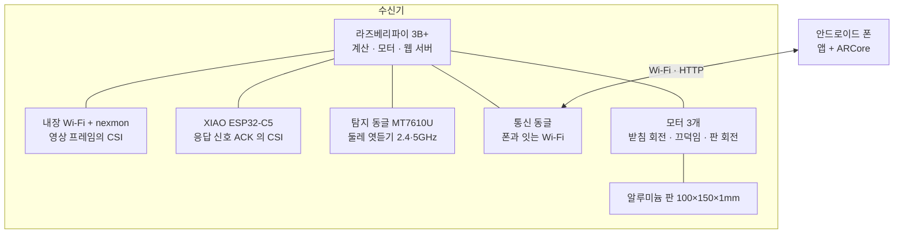
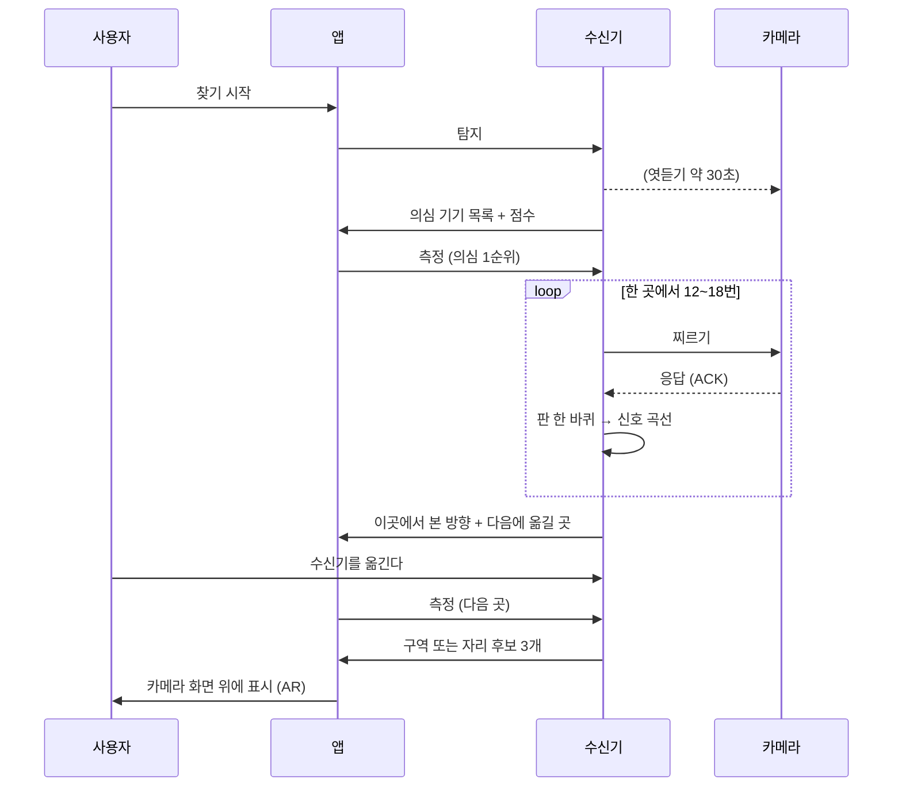

# 시스템 설계서

[시스템 명세 000](../specs/000-system/spec.md)을 어떻게 만드는지 적은 문서입니다. 수신기 안쪽의 자세한 설계는 [receiver/docs](https://github.com/DeteCam/receiver/tree/main/docs)에 있습니다.

## 1. 구성

| 부품 | 맡은 일 | 왜 따로 두는가 |
|---|---|---|
| 내장 Wi-Fi (nexmon) | 카메라가 내보내는 영상 프레임에서 전파 값(CSI)을 잰다. 2.4·5GHz, 20~80MHz | 넓은 대역의 프레임을 재는 것은 이 칩만 된다 |
| ESP32-C5 | 카메라를 짧게 찔러 돌아오는 응답(ACK)에서 CSI 를 잰다 | nexmon 은 ACK 에서 CSI 를 내지 않는다. 카메라가 조용할 때도 잴 수 있게 된다 |
| 탐지 동글 | 모든 채널을 돌며 누가 얼마나 보내는지 듣는다 | 내장 Wi-Fi 는 CSI 를 재는 동안 한 채널에 묶인다 |
| 통신 동글 | 폰이 붙는 Wi-Fi 를 연다 | 위 셋이 모두 듣는 일에 쓰인다 |

무선 부품이 넷이라 겹쳐 보이지만 하는 일이 서로 다르다. 하나로 줄이면 재는 동안 폰과 끊기거나, 탐지와 측정을 같이 못 한다.

## 2. 동작 순서

## 3. 방향과 위치를 내는 방법

1. **판 돌리기.** 안테나 둘레로 알루미늄 판을 한 바퀴 돌리며 신호 세기를 잰다. 판이 카메라와 안테나 사이에 오면 신호가 달라진다.
2. **곡선 전체 맞추기.** 방 안에서는 반사 때문에 곡선이 복잡하다. "가장 약한 곳"만 보면 틀린다. 카메라가 어느 방향에 있을 때 곡선이 어떻게 생기는지 미리 구해 둔 **기준 곡선**과 곡선 전체를 견주어, 가장 닮은 방향을 고른다.
3. **기울여 여러 번.** 머리를 세 가지 각도로 숙이고 받침을 여섯 방향으로 돌려 한 곳에서 12~18번 잰다. 위아래 방향까지 알 수 있고, 한 번의 우연에 덜 흔들린다.
4. **여러 곳 겹치기.** 곳마다 "각 자리에 카메라가 있다면 이런 곡선이 나왔을 가능성"을 구해 곱한다. 한 곳이 크게 틀려도 결과가 뒤집히지 않게 바닥값을 둔다.
5. **다음 곳 고르기.** 지금까지의 후보들이 가장 잘 갈라져 보이는 곳을 다음 측정 자리로 권한다.

교실 계산에서 2번(곡선 전체 맞추기)을 쓰지 않고 가장 약한 곳만 보면 자리를 맞힌 비율이 6% 로, 찍는 것과 다르지 않았다. 2번을 쓰면 90% 였다. 자세한 숫자는 [교실 전파 시뮬레이션](../verification/교실%20전파%20시뮬레이션.md).

## 4. 주고받는 것

| 사이 | 내용 | 형식 |
|---|---|---|
| 앱 → 수신기 | 탐지, 판별, 측정, 시험장 설정, 멈춤 | HTTP POST + JSON |
| 수신기 → 앱 | 상태, 의심 기기 표, 방향, 구역, 자리 후보, 다음에 옮길 곳 | HTTP GET + JSON |
| 수신기 → 파일 | 스캔 곡선, 점검 기록 | `.npz`, `.jsonl` |
| 분석 → 수신기 | 점수 가중치, 기준 곡선 표 | `.json`, `.npz` |

주소 목록은 [주소 계약](https://github.com/DeteCam/app/blob/main/docs/주소%20계약.md) 한 곳에만 적는다.

## 5. 설계에서 고른 것

| 고른 것 | 다른 길 | 까닭 |
|---|---|---|
| 판을 돌려 방향 찾기 (회절) | 안테나 여러 개로 각도 재기 | 값싼 부품 하나의 안테나로 된다. 선행 연구(DiffLoc)가 있다 |
| 곡선 전체 맞추기 | 가장 약한 곳 찾기 | 반사가 많은 방에서 뒤쪽은 거의 틀린다 |
| 수신기를 옮겨 가며 재기 | 수신기 여러 대 | 한 대로 된다. 대신 시간이 든다 |
| 높이 2.4m 스탠드 | 책상 높이, 천장 고정 | 앉은 사람 몸이 전파를 가린다. 천장 고정은 정확하지만 미리 달아야 한다 |
| 의심 점수 하나 | 숙소 모드 / 시험장 모드 | 쓰는 사람이 고를 것이 없다 |
| 계산은 수신기에서 | 폰이나 클라우드에서 | 폰이 끊겨도 측정이 이어진다 |
