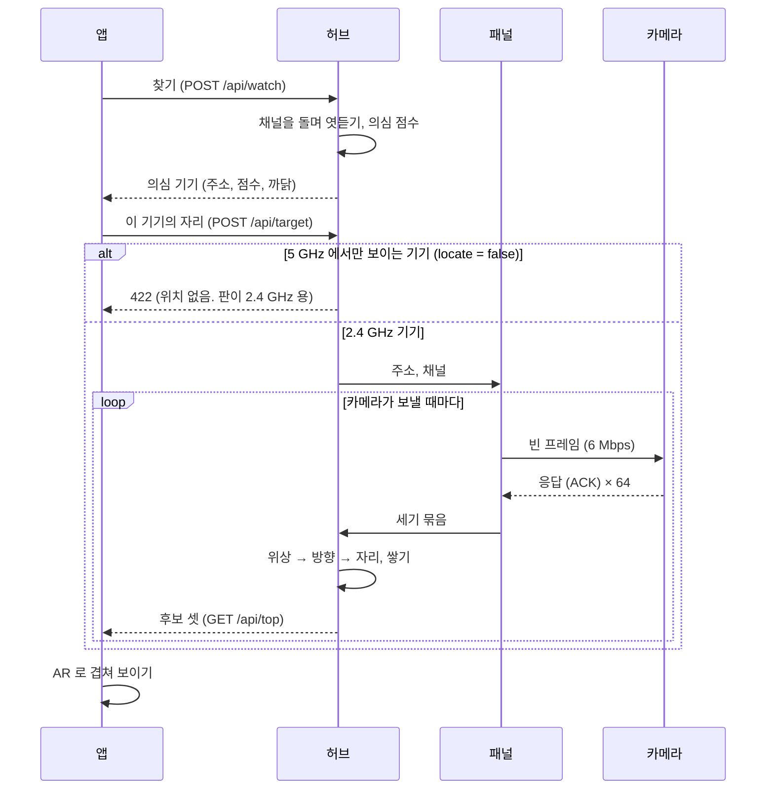

# 시스템 설계서

DeteCam 의 덩어리, 동작 순서, 주고받는 것, 그리고 설계에서 고른 것과 그 까닭을 적는다. 그림과 치수의 원본은 receiver 저장소의 [설계도](https://github.com/DeteCam/receiver/blob/main/docs/%EC%84%A4%EA%B3%84%EB%8F%84.md)에 있다.

## 1. 구성

| 덩어리 | 하는 일 | 무엇으로 |
|---|---|---|
| 패널 (둘) | 고른 기기의 전파가 오는 방향을 잰다 | 안테나 배열 보드(150 × 150 mm, 패치 16개, 16갈래 스위치), XIAO ESP32-C5, RF 스위치 둘, 합침기, 3D 출력 통 (165 × 225 × 38 mm, 약 0.6 kg) |
| 허브 | 둘레의 Wi-Fi 를 엿들어 의심 기기를 고르고, 패널이 잰 세기로 방향과 자리를 셈하고, 폰에 결과를 준다 | 라즈베리파이 3B+, 동글 둘(탐지, 통신), 보조배터리 |
| 앱 | 수신기 조종, 패널 자리 등록(AR 마커), 의심 자리 AR 표시 | 안드로이드, Kotlin, ARCore |
| 분석 | 의심 점수와 자리 모델을 학습해 파일로 낸다 | Python, PyTorch, Sionna RT |

## 2. 패널이 방향을 재는 법

1. **안테나를 바꿔 가며 받는다.** 패널의 안테나 16개를 전자 스위치로 하나씩 고른다. 같은 전파를 16자리에서 받으면, 자리마다의 위상 차이에서 전파가 온 방향이 나온다.
2. **세기만 잰다.** ESP32 는 수신 길이 하나라 패킷마다 위상의 기준이 달라진다. 그래서 기준 안테나의 신호와 고른 안테나의 신호를 합쳐 세기만 잰다. 기준 길의 위상을 0·90·180·270도로 바꾸면 세기 넷에서 위상이 나온다 (위상 배열 안테나 보정의 REV 법과 같은 셈). 한 번 재기 = 안테나 16 × 위상 4 = 패킷 64개, 약 0.3초.
3. **두 방향이 만나는 곳.** 패널 둘이 잰 방향의 점수를 자리마다(교실) 또는 방의 겉면 점마다(숙소) 곱하고, 카메라가 보낼 때마다 쌓는다. 후보 세 곳과 확률을 낸다.
4. **등진 쪽은 버린다.** 한 자리에서 패널을 돌려 가며 잴 때, 카메라를 등진 쪽은 반사만 받아 엉뚱한 곳을 짚는다. 받은 세기가 가장 센 쪽보다 6 dB 넘게 약한 쪽은 버린다.

## 3. 동작 순서

## 4. 주고받는 것

| 무엇 | 내용 | 꼴 |
|---|---|---|
| 패널 → 허브 | 패널 번호, 시각, 대상 주소, 채널, 패킷 64개마다 (안테나, 위상 단계, 이득, 서브캐리어 52개의 세기) | 이진 묶음 (USB · ESP-NOW) |
| 허브 ↔ 앱 | 상태, 기기 표, 패널 표, 후보 셋 | HTTP + JSON ([주소 계약](https://github.com/DeteCam/app/blob/main/docs/주소%20계약.md)) |
| 수신기 → 파일 | 세기 묶음, 점검 기록 | `.npz`, `.jsonl` |
| 분석 → 수신기 | 의심 점수 가중치, 자리 모델 | `.json`, `.onnx` |

## 5. 소프트웨어

| 덩어리 | 일 | 지금 |
|---|---|---|
| 패널 장치 코드 (C, ESP-IDF) | 엿듣기, 찌르기와 응답 받기, 스위치 순서, 이득 보정, 허브로 보내기 | 아직 (관문 1~3 에서 만든다) |
| 허브 프로그램 (Python) | 탐지기와 의심 점수, 패널 계산, 위치 추정, 보정, API | 탐지와 패널 계산은 만들어 검사함 |
| 앱 (Kotlin, ARCore) | 연결과 조종, 패널 자리 등록, 자리표·방 훑기, AR 표시, 기록 | 스펙 |
| 분석 (Python, PyTorch) | 학습 자료 만들기(전파 시뮬레이션), 의심 점수 모델, 자리 모델, 실측으로 고치기, 평가 | 시뮬레이션과 평가는 있음 |

## 6. 설계에서 고른 것

| 고른 것 | 견준 것 | 까닭 |
|---|---|---|
| 안테나 16개 패널, 전자 스위치 | 판을 돌리는 수신기(앞선 구조), 안테나 4개 패널, 세기만 재는 수신기 여럿 | 판을 돌리면 직접 보이는 카메라도 9도쯤 틀려 두 곳으로는 자리를 못 가른다. 세기만 재는 수신기 20개도 가슴·안경 카메라를 28~39% 만 맞힌다. 안테나 4개는 9만 원 싸고 4~8점 낮다 ([사전 검증](https://github.com/DeteCam/receiver/blob/main/docs/%EC%82%AC%EC%A0%84%20%EA%B2%80%EC%A6%9D.md)) |
| ESP32 하나로 세기만 재서 위상 되찾기 | 수신 넷이 한꺼번에 받는 장비, ESP32 여러 대의 위상 맞추기 | 2.4 GHz 에서 CSI 를 내는 4체인 장비가 마땅치 않다. 세기 재기는 흔들림에 버틴다 (이득 2 dB, 위상 20도) |
| 패널 둘을 벽에 걸어 두기 | 수신기를 여러 곳으로 옮기기 | 시험 중에는 옮길 수 없다. 걸어 두면 사람들이 자세를 바꾸는 사이 보이는 순간을 모은다 |
| 의심 점수 하나로 몰카와 시험장 | 모드 나누기 | 사용자가 상황을 고르지 않아도 된다 |
| 허브(라즈베리파이)부터 | 처음부터 폰이 계산 | 가진 것이고 탐지 코드가 있다. 패널이 된 뒤 뺀다 |
| 부품을 다섯 관문으로 나눠 사기 | 한꺼번에 사기 | 가장 위험한 두 가지가 처음 6.6만 원 안에서 결판난다 |
