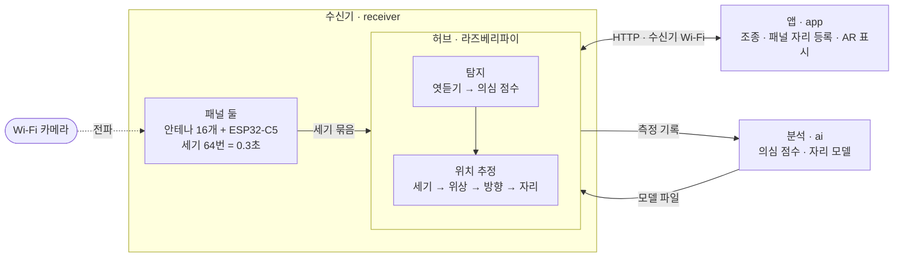

# 000 시스템 전체: 방법

## 나누기

- **패널**이 재고 **허브**가 계산한다. 폰이 없어도 측정은 끝까지 간다.
- **앱**은 시키고 보여 준다. 계산은 하지 않는다 (AR 좌표 맞추기만 한다).
- **분석**은 오프라인이다. 수신기가 남긴 기록과 전파 시뮬레이션으로 모델을 만들어 파일로 넣는다. 수신기는 실행 중에 클라우드를 쓰지 않는다.
- **허브는 뺄 수 있다.** 첫 시제품은 가진 라즈베리파이를 허브로 쓴다. 패널이 실물에서 된 뒤에는 패널이 엿듣고 폰이 계산하게 옮긴다 (패널 ↔ 폰 블루투스).

## 주고받는 것

| 사이 | 방식 | 정한 곳 |
|---|---|---|
| 패널 → 허브 | USB 또는 ESP-NOW. 세기 묶음 (안테나, 위상 단계, 이득, 서브캐리어 52개) | [receiver 설계도](https://github.com/DeteCam/receiver/blob/main/docs/%EC%84%A4%EA%B3%84%EB%8F%84.md) 4.5절 |
| 앱 ↔ 허브 | 허브가 여는 Wi-Fi(`DeteCam-RX`) 위의 HTTP + JSON | [app/docs/주소 계약](https://github.com/DeteCam/app/blob/main/docs/주소%20계약.md) |
| 수신기 → 분석 | 측정 기록 파일 (세기 묶음, 점검 기록) | [ai/data](https://github.com/DeteCam/ai/tree/main/data) |
| 분석 → 수신기 | 의심 점수 가중치, 자리 모델 (파일) | ai 스펙 001·002 |
| 앱 ↔ 패널 자리 | 패널 앞덮개의 AR 마커 | app 스펙 002 |

## 단계

| 단계 | 내용 | 끝났다는 기준 |
|---|---|---|
| 0. 가능성 확인 (끝) | 계산과 시뮬레이션으로 구조와 한계를 정한다. 부품을 사기 전에 확인할 수 있는 것을 확인한다 | 설계 검토, 사전 검증, 교실·숙소 방 계산 |
| 1. 패널 (관문 1~4) | 싼 부품부터 사서 확인하며 패널 하나를 만든다 | G-3, 탁상 데모 |
| 2. 탐지와 위치 (관문 5) | 패널 둘과 허브, 의심 점수 실험, 숙소 방과 강의실 측정 | G-1, G-2, G-4, G-5 |
| 3. 앱 | 조종과 AR 표시 | 시나리오 1·2 시연, G-7 |
| 4. 다듬기 | 배운 모델, 허브 없는 구성, 실패한 경우 분석, 문서와 발표 | 수용 기준 |

## 위험과 대비

| 위험 | 대비 |
|---|---|
| ESP32-C5 가 ACK 의 CSI 를 못 낸다 | 카메라가 스스로 보내는 프레임만으로 잰다. 쉬고 있는 카메라는 못 잰다 |
| 세기만으로 위상이 되찾아지지 않는다 | 이득 보정, 단계마다 세 번 재기, 뛴 묶음 버리기. 그래도 안 되면 돌판 수신기([receiver-legacy](https://github.com/DeteCam/receiver-legacy), 태그 `plate-v2`)로 돌아간다. 이때까지 쓰는 돈은 6.6만 원이다 |
| 교실에서 계산만큼 안 나온다 | 전송을 더 쌓는다(여덟 번), 패널을 하나 더 건다(칠판 윗변), 후보를 3개에서 5개로 넓힌다 |
| 보드의 치수가 어림과 다르다 | 관문 4 에서 보드를 재서 `cad/model/panel.py` 를 고치고 다시 뽑는다 |
