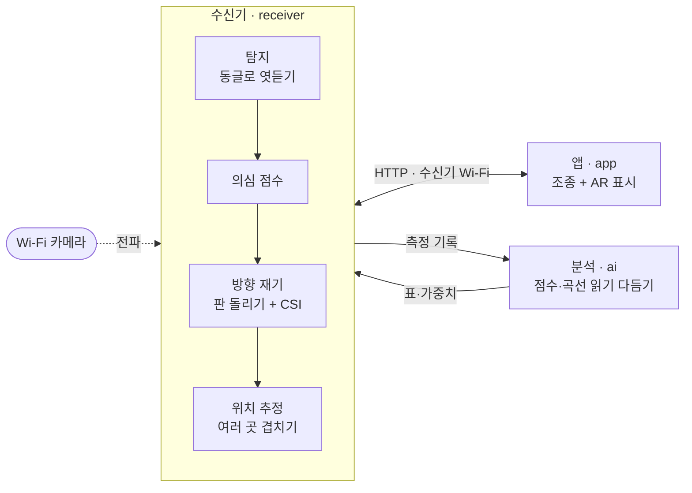

# 000 시스템 전체: 방법

## 나누기

- **수신기**가 재고 계산한다. 폰이 없어도 측정은 끝까지 간다.
- **앱**은 시키고 보여 준다. 계산은 하지 않는다 (AR 좌표 맞추기만 한다).
- **분석**은 오프라인이다. 수신기가 남긴 기록으로 점수 가중치와 기준 곡선을 만들어 수신기 저장소에 파일로 넣는다. 수신기는 실행 중에 클라우드를 쓰지 않는다.

## 주고받는 것

| 사이 | 방식 | 정한 곳 |
|---|---|---|
| 앱 ↔ 수신기 | 수신기가 여는 Wi-Fi(`DeteCam-RX`) 위의 HTTP + JSON | [app/docs/주소 계약](https://github.com/DeteCam/app/blob/main/docs/주소%20계약.md), [receiver 스펙 005](https://github.com/DeteCam/receiver/tree/main/specs/005-standalone-control) |
| 수신기 → 분석 | 측정 기록 파일 (스캔 곡선, 점검 기록) | [ai/data](https://github.com/DeteCam/ai/tree/main/data) |
| 분석 → 수신기 | 점수 가중치, 기준 곡선 표 (파일) | ai 스펙 001·002 |
| 앱 ↔ 수신기 자리 | 수신기 등판의 AR 마커 | app 스펙 002 |

## 단계

| 단계 | 내용 | 끝났다는 기준 |
|---|---|---|
| 0. 가능성 확인 (지금) | 계산과 시뮬레이션으로 방법과 한계를 정한다 | 교실 시뮬레이션, 설계 검토 문서 |
| 1. 수신기 실물 | 출력 · 조립 · 펌웨어, 기준 곡선 실측 | G-3 실측 |
| 2. 탐지와 위치 | 의심 점수 실험, 방과 강의실 측정 | G-1, G-2, G-4, G-5 실측 |
| 3. 앱 | 조종과 AR 표시 | 시나리오 1·2 시연, G-7 |
| 4. 다듬기 | 실패한 경우 분석, 문서와 발표 | 수용 기준 |

## 위험과 대비

| 위험 | 대비 |
|---|---|
| ESP32 가 ACK 의 CSI 를 못 낸다 | 라즈베리파이(nexmon)로 카메라의 영상 프레임만 잰다. 카메라가 계속 내보내는 동안만 잴 수 있다 |
| 실물의 신호 곡선이 계산과 다르다 | 기준 곡선을 실물로 잰 값으로 바꾼다 (receiver 스펙 001 의 보정 절차) |
| 교실에서 계산만큼 안 나온다 | 재는 곳 수를 늘린다(8곳), 천장 가운데 한 곳을 더한다, 후보를 3개에서 5개로 넓힌다 |
| 28BYJ-48 모터가 느리다 | 한 곳 12번 재기로 줄인다 (계산상 정확도 차이 작음) |
