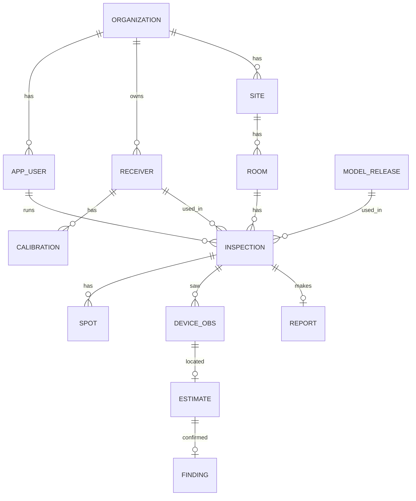

# SPEC-001: 서버 · DB · 클라우드 (점검 기록, 모델 · 보정표 배포, 웹 관리 화면)

- 상태: **설계 (2026-11-27)**. 구현 전. 서버 코드는 구현할 때 새 저장소(`DeteCam/server`)에 둔다.
- 기준: [AGENTS.md](../../AGENTS.md)(R9 기기 사이는 무선, R10 · R11 좌석 정보 · 좌석마다 기기 금지), [SPEC-000](../000-system/spec.md)(NFR-8 노트북 없이 수신기와 폰만으로 동작), 앱 ↔ 수신기 [주소 계약](https://github.com/DeteCam/app/blob/main/docs/주소%20계약.md).
- 바뀐 이유: 종합설계는 프론트엔드 · 백엔드 · DB · 클라우드를 모두 갖춰야 한다(2026-2 설명회: "단일 앱만 개발 불가, 앱은 반드시 서버와 연동"). 지금까지는 수신기와 앱만 설계했다.

## 1. 무엇을, 왜

**측정은 서버 없이 한다. 서버는 측정 앞뒤를 맡는다.** 시험장 · 숙소에는 인터넷이 없을 수 있고, 측정 중에는 수신기와 폰만 무선으로 이어야 한다(R9 · NFR-8). 그래서 서버가 없어도 점검이 끝나게 만들고, 서버는 다음 네 가지를 한다.

1. **점검 기록 보관.** 점검이 끝나면 폰이 점검 요약(장소 · 방 · 측정 자리 · 판별 결과 · 추정 위치 · 신뢰도 · 사용자가 확인한 결과)을 올린다. 같은 방을 다시 점검할 때 지난 결과와 견준다.
2. **모델 · 보정표 배포.** 카메라 판별 모델(ai SPEC-001), 추정기 설정, 수신기마다의 보정표(receiver SPEC-002 "보정")를 버전으로 관리한다. 폰은 점검 전에 최신 판을 받아 두었다가 수신기에 넘긴다.
3. **모델 개선 고리.** 사용자가 "여기서 카메라를 찾았다 / 카메라가 아니었다"를 확인한 결과를 라벨로 모은다. 원본 캡처가 아니라 요약 특징만 모은다. 학습은 노트북 · Colab에서 하고(AGENTS.md 4장) 새 모델을 서버에 올려 배포한다.
4. **웹 관리 화면.** 기관(시험장 · 숙박업소 점검 단체) 관리자가 점검 이력, 방별 결과, 보고서(PDF)를 본다. 점검자 계정과 수신기를 등록한다.

## 2. 구조

```
[수신기 CM4] ──BLE── [폰 앱 (Android, ARCore)] ──HTTPS(점검 앞뒤만)── [백엔드 API (Spring Boot)] ── [PostgreSQL (AWS RDS)]
                          │ 로컬 DB(Room) + 보낼 목록                       │                              
                          │                                                  ├── [S3: 모델 · 보정표 · 보고서 PDF · 방 윤곽]
[웹 관리 화면 (React)] ──HTTPS──────────────────────────────────────────────┘    └── [FCM: 새 모델 · 보고서 알림]
```

| 부분 | 기술 | 하는 일 | 비고 |
|---|---|---|---|
| 프론트엔드 1: 폰 앱 | Android(Kotlin), ARCore, Room(SQLite), WorkManager | 수신기 조종 · AR 표시(app SPEC-001 · 002). 점검 기록을 폰에 먼저 저장하고, 인터넷이 될 때 올림 | 서버가 꺼져 있어도 점검이 끝남 |
| 프론트엔드 2: 웹 관리 화면 | React + TypeScript, S3 + CloudFront | 점검 이력 · 방별 결과 · 보고서 · 계정 · 수신기 · 모델 판 관리 | 기관 관리자용 |
| 백엔드 | Spring Boot 3(Java 21), Spring Security(JWT), Spring Data JPA, OpenAPI 문서 | 인증, 점검 기록 받기 · 조회, 모델 · 보정표 배포(S3 미리 서명된 주소), 보고서 만들기 | 한 개의 서버로 시작 |
| DB | PostgreSQL 16 (AWS RDS) | 기관 · 사용자 · 수신기 · 보정표 · 모델 판 · 장소 · 방 · 점검 · 자리 · 관측 기기 · 추정 · 확인 결과 | 3절 |
| 파일 저장 | AWS S3 | 모델 파일(TFLite/ONNX), 보정표(npz), 보고서 PDF, 방 윤곽(벽 · 바닥 면 몇 장) | 원본 CSI · 캡처는 올리지 않음 |
| 알림 | Firebase Cloud Messaging | 새 모델 판 승인, 보고서 완성 | 선택 |
| 배포 | AWS(EC2 또는 ECS Fargate + RDS + S3 + CloudFront), GitHub Actions(빌드 · 시험 · 배포), CloudWatch | 비용: 프리 티어 안에서 시작 | 시연 뒤 자원 정리 |

## 3. 데이터 (DB 표)



| 표 | 주요 열 | 설명 |
|---|---|---|
| organization | id, name, kind(시험장 / 숙박 점검 / 기타) | 기관 |
| app_user | id, org_id, email, password_hash, role(관리자 / 점검자 / 열람자) | 계정 |
| receiver | id, org_id, serial, hw_rev, firmware_ver | 수신기 1기 = 1행 |
| calibration | id, receiver_id, version, surface(유전체 / 금속), channel_set, s3_key, sha256 | 수신기마다의 보정표 |
| model_release | id, kind(판별 / 추정기 설정), version, s3_key, sha256, metrics(json), status(초안 / 승인 / 내림) | 모델 판. 승인된 판만 폰이 받음 |
| site, room | id, org_id / site_id, name, kind(시험실 · 숙소 · 화장실 · 목욕탕 · 탈의실), dims | 장소와 방. **좌석 배치도 열은 두지 않는다**(R10) |
| inspection | id, room_id, user_id, receiver_id, model_release_id, calibration_id, started_at, ended_at, bands, status | 점검 1회 |
| spot | id, inspection_id, seq, x, y, z, yaw, kind(W · F · T · B), surface | 수신기를 둔 자리 |
| device_obs | id, inspection_id, oui, mac_hash, band, channel, pkt_rate, features(json), camera_prob, judged | 관측한 기기. **MAC 원본은 저장하지 않는다**(4절) |
| estimate | id, device_obs_id, bearing(json), x, y, z, sigma_m, zone(json), confidence, method_ver | 추정 위치 · 의심 구역 |
| finding | id, estimate_id, confirmed(찾음 / 아님 / 모름), found_xyz, note | 사용자가 확인한 결과(모델 개선 라벨) |
| report | id, inspection_id, s3_key | 보고서 PDF |
| audit_log | id, user_id, action, target, at | 누가 무엇을 봤는지 |

## 4. 개인정보 · 보안

- **올리지 않는 것:** CSI 원본, 패킷 캡처(pcap), 다른 사람 기기의 MAC 주소 원본, 영상 · 사진(사용자가 고른 증거 사진만 동의 뒤 선택). AGENTS.md 9장(남의 기기 MAC · 원본 캡처를 올리지 않음)과 같은 원칙이다.
- **MAC은 두 가지로만 남긴다:** 제조사 앞 3바이트(OUI)와 점검마다 새로 만든 소금값을 섞은 해시. 소금값은 점검이 끝나면 폰에서 지운다. 같은 점검 안에서만 같은 기기를 묶을 수 있고 나중에 되찾을 수 없다.
- HTTPS만 쓴다. 로그인은 JWT(접근 토큰 15분 · 갱신 토큰 14일). 기관 단위로 행 접근을 막는다(다른 기관의 점검을 볼 수 없음).
- 시험장 기록은 좌석 정보를 담지 않는다(R10). 의심 책상은 그 점검의 AR 좌표로만 남는다.
- 보관 기간: 기본 1년, 기관 관리자가 지울 수 있음. 지운 기록은 감사 기록만 남는다.

## 5. 주소(API) 계약 (서버, v1)

| 이름 | 방법 | 설명 |
|---|---|---|
| `/api/v1/auth/login`, `/auth/refresh` | POST | 로그인, 토큰 갱신 |
| `/api/v1/receivers/{serial}/calibration/latest` | GET | 그 수신기의 최신 보정표 정보 + 내려받을 주소 |
| `/api/v1/models/latest?kind=classifier` | GET | 승인된 최신 모델 정보 + 내려받을 주소 |
| `/api/v1/oui/latest` | GET | 제조사 표(카메라 제조사 목록 포함) |
| `/api/v1/inspections` | POST | 점검 만들기(폰이 만든 UUID로, 같은 요청을 두 번 보내도 하나만 생김) |
| `/api/v1/inspections/{id}` | PUT · GET | 점검 마치기 · 조회 |
| `/api/v1/inspections/{id}/spots` · `/observations` · `/estimates` | POST | 자리 · 관측 기기 · 추정을 묶어서 올림 |
| `/api/v1/estimates/{id}/finding` | POST | 사용자가 확인한 결과 |
| `/api/v1/inspections/{id}/report` | GET | 보고서 PDF |
| `/api/v1/rooms/{id}/inspections` | GET | 같은 방 점검 이력(지난 결과와 견주기) |
| `/api/v1/admin/models` · `/admin/calibrations` · `/admin/users` | POST · PATCH | 관리자: 모델 판 올리기 · 승인, 보정표 등록, 계정 |

- 폰 앱은 점검 기록을 먼저 로컬 DB에 쓰고 "보낼 목록"에 넣는다. 인터넷이 되면 WorkManager가 순서대로 보낸다. 모든 요청은 같은 것을 두 번 보내도 결과가 같다.
- 응답 형식과 오류 코드는 서버 저장소의 OpenAPI 문서로 고정하고, 앱과 웹이 같은 문서에서 코드를 만든다.

## 6. 요구사항

| 번호 | 요구사항 | 수용 기준 | 확인 방법 |
|---|---|---|---|
| FR-1 | 서버 없이 점검 | 비행기 모드에서 점검을 처음부터 끝까지 마칠 수 있다 | 시연(V6) |
| FR-2 | 기록 올리기 | 인터넷이 되면 쌓인 점검이 모두 올라간다. 중간에 끊겨도 빠지거나 두 번 들어가지 않는다 | 통합 시험(연결을 끊었다 붙이기 20회) |
| FR-3 | 판 배포 | 승인된 모델 · 보정표만 내려가고, 폰이 sha256을 확인한 뒤 수신기에 넘긴다 | 통합 시험 |
| FR-4 | 웹 관리 화면 | 기관 관리자가 방별 점검 이력 · 결과 지도 · 보고서를 본다 | 시연 |
| FR-5 | 지난 결과 견주기 | 같은 방을 다시 점검하면 지난 의심 구역을 함께 보여 준다 | 시연 |
| NFR-1 | 개인정보 | DB · S3에 MAC 원본 · CSI · 캡처가 없다 | DB 열 · S3 객체 검사 스크립트 |
| NFR-2 | 접근 제어 | 다른 기관 계정으로 점검 조회 시 403 | API 시험 |
| NFR-3 | 성능 | 점검 1회 올리기(자리 8곳 · 기기 30대) 3초 안(4G) | 부하 시험(k6) |
| NFR-4 | 비용 | 시연 기간 AWS 비용 월 1만 원 미만(프리 티어) | 청구서 |

## 7. 일정 (요약 계획서 · 발표자료와 같음)

| 시기 | 서버 · DB · 클라우드 |
|---|---|
| 2026-12 ~ 2027-02 (겨울방학) | 표 설계(JPA), 로그인 · 점검 올리기 · 조회 API, Docker로 로컬 실행, GitHub Actions 시험 |
| 2027-03 | AWS 배포(RDS · S3 · CloudFront), 모델 · 보정표 배포, 앱 동기화 |
| 2027-04 (데모 발표) | 웹 관리 화면(이력 · 지도 · 보고서) |
| 2027-05 ~ 06 | 개인정보 검사 스크립트, 부하 · 끊김 시험, 최종 시연 |

## 8. 범위 밖

- 측정 중 실시간으로 CSI를 서버에 보내기(R9 · 개인정보 · 인터넷 없는 현장 때문에 하지 않음).
- 서버에서 위치를 다시 계산하기. 계산은 수신기 · 폰에서 끝낸다. 서버는 기록 · 배포 · 관리만 한다.
- 결제 · 다중 언어.
