# 구매 부품 목록 (16소자 스위치 고리 수신기 1기)

> 상태(2026-11-26 밤 확인, 2026-11-27 배선 확정 · 납땜 없는 부품으로 바꿈 반영): **아직 사지 않았다.** [AGENTS.md](AGENTS.md) 8장 규칙에 따라 1기분만 먼저 사서 벤치 시험을 한다.
> 값 · 재고 · 배송 예정일은 **2026-11-26 23시~23시 40분에 판매 페이지에서 직접 본 값**이다(크롬, 배송지 경기 시흥시, 알리익스프레스는 로그인한 계정 화면). 사기 전에 다시 확인한다.
> 그림은 설계값으로 직접 그린 것이며 판매 사진이 아니다. 부품 구성의 기준은 [현재_방향.md](현재_방향.md) 7절이다.

## 1. 부품 표 (1기분)

| 그림 | 부품 | 수량 | 값 | 재고 | 배송비 · 배송 예정 | 하는 일 |
|---|---|---|---|---|---|---|
| 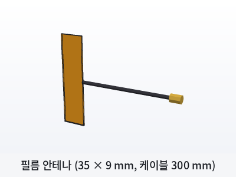 | [Molex 146153-9300 필름 안테나](https://www.digikey.kr/en/products/detail/molex/1461539300/17630113) (U.FL, 케이블 300 mm) | 17 + 예비 3 | 10개부터 개당 ₩4,210 → 20개 ₩84,202 (1개 ₩4,878) | 6,243 | ₩60,000 이상 무료. 재고품(미국 출고), 도착일은 결제 화면에서 확인 | 고리 소자 16개 + 기준 안테나 1개. 35 × 9 mm, 2.4 · 5 · 6 GHz |
| 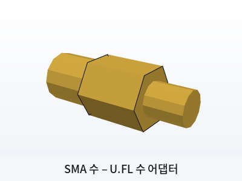 | [SMA 수 – U.FL(IPX) 수 어댑터](https://ko.aliexpress.com/item/1005005685444847.html) | 17 + 예비 3 | 개당 ₩691 → ₩13,820 | 12,878 | ₩1,700 · 11/30~12/07 | 필름 안테나 케이블(U.FL)을 스위치 · 분배기의 SMA에 꽂는다 |
| 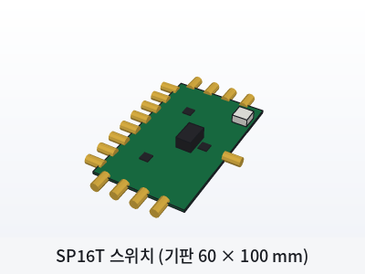 | [SP16T Core Board](https://ko.aliexpress.com/item/1005011848596627.html) (9 kHz~8 GHz, 옵션 "SP16T Core Board") | 1 | ₩109,990 (할인 12/3 23:59까지, 원가 ₩244,422) | 85 | 무료 · 12/01~12/07 | 고리 소자 16개 가운데 하나를 고른다. 기판 60 × 100 mm, SMA 암 17개, 5 V |
| 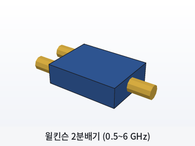 | [윌킨슨 2분배기 0.5~6 GHz](https://ko.aliexpress.com/item/1005011591580045.html) | 2 | 개당 ₩9,100 → ₩18,200 | 5개 남음 | 무료 · 12/01~12/07 | 기준 신호를 나눠 앵커를 만들고, 앵커와 스위치 신호를 합친다 |
| 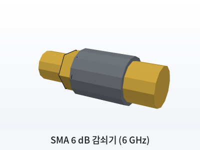 | [SMA 고정 감쇠기 6 dB / 6 GHz](https://ko.aliexpress.com/item/1005009745508935.html) (옵션 6dB · 6GHz) | 2 | 개당 ₩3,400 → ₩6,800 | 658 | ₩4,146 · 12/01~12/09 | 하나는 스위치 공통 포트 뒤(앵커 마진), 하나는 AX210 체인 B 앞(체인 가르기) |
| 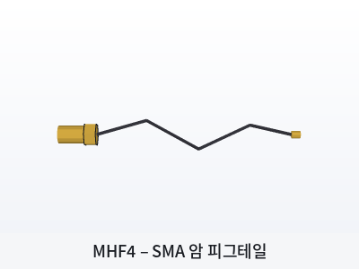 | [MHF4 – SMA 암 피그테일 2개](https://ko.aliexpress.com/item/4000086100103.html) (옵션 "SMA-K Female", 10 cm) | 1묶음 | ₩1,506 | 표시 없음 | 무료 · 11/27~12/06 | AX210의 두 단자(MHF4)를 SMA로 꺼낸다 |
| 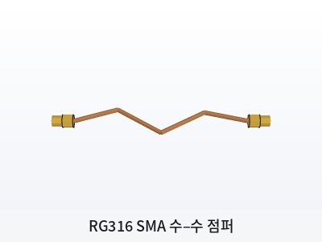 | [RG316 SMA 수–수 점퍼 5개](https://ko.aliexpress.com/item/1005006481907718.html) (10~15 cm) | 1묶음 | ₩2,422 | 표시 없음 | 무료 · 12/02~12/07 | 분배기 · 감쇠기 · 피그테일 사이를 잇는다(4개 사용) |
| 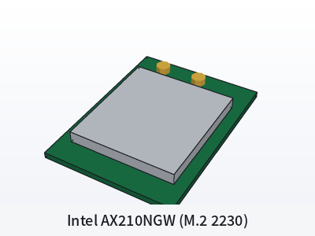 | [Intel AX210NGW](https://ko.aliexpress.com/item/1005007345287555.html) (M.2 2230, 안테나 세트 상품) | 1 | ₩21,700 | 표시 없음 | 무료 · 12/01~12/07 | 두 수신 단자로 CSI를 받는 무선랜 카드 |
| 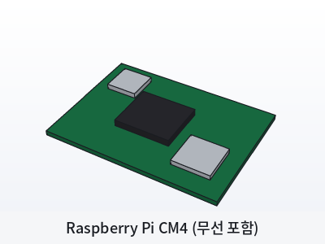 | [Raspberry Pi CM4 Lite 2GB 무선(CM4102000)](https://kr.element14.com/raspberry-pi/cm4102000/rpi-compute-module-4-lite-2gb/dp/3563483) | 1 | ₩87,073 | 1,199 | 3~4 영업일(영국 재고). 블랙프라이데이 지연 안내 있음 | 호스트. 무선 포함 모델이어야 폰과 BLE로 잇는다 |
| 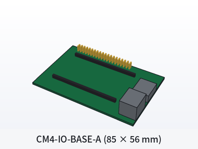 | [Waveshare CM4-IO-BASE-A](https://www.waveshare.com/cm4-io-base-a.htm) (V3.1 이상) | 1 | $18.99 (약 ₩25,640) | 표시 없음 | 배송비 · 도착일은 결제 화면에서 정해짐(미확인) | CM4를 꽂는 보드. 85 × 56 mm, M.2 M-key 슬롯 |
| 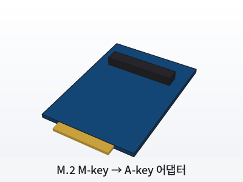 | [Waveshare M.2 M KEY → A KEY 어댑터](https://www.waveshare.com/product/m.2-m-key-to-m.2-a-key.htm) | 1 | $7.99 (약 ₩10,790) | 표시 없음 | 위와 같이 주문 | 캐리어의 M-key 슬롯에 AX210(A/E-key)을 꽂게 해 준다 |
| 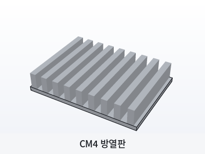 | [CM4 알루미늄 방열판](https://ko.aliexpress.com/item/1005009267532572.html) | 1 | ₩1,506 | 표시 없음 | ₩1,548 · 12/02~12/08 | CM4 냉각(싼 방열판만 쓰기로 함). **높이 10 mm 이하**(위에 SP16T 선반이 있음) |
| — | microSD 32 GB | 1 | 약 ₩8,000 (국내, 값 미확인) | — | 국내 택배 | OS 이미지(2026-04-13판) |
| 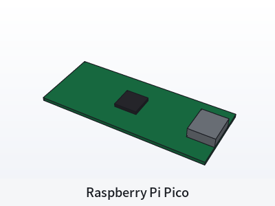 | [Raspberry Pi Pico H](https://ko.aliexpress.com/item/1005008058623788.html) (옵션 "Pico H", **핀 납땜되어 나옴**) | 1 | ₩6,574 | 표시 없음 | 무료 · 12/01~12/07 | 스위치 제어선 9개와 끄덕이기 모터를 구동 |
| 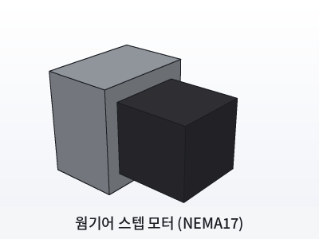 | [NEMA17 웜기어 스텝 모터(5840 감속기)](https://ko.aliexpress.com/item/1005008325671689.html) | 1 | ₩21,428 | 표시 없음 | ₩7,140 · 12/01~12/10 | 머리를 −20° · 0° · +20°로 끄덕인다. 전원을 꺼도 자세가 유지된다 |
| 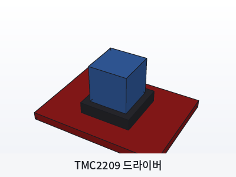 | [MKS TMC2209 V2.0 스텝 드라이버](https://ko.aliexpress.com/item/1005008704098385.html) (StepStick, 핀 납땜되어 나옴) | 1 | ₩2,218 | 표시 없음 | Choice 상품(배송일은 결제 화면에서 확인) | 조용한 모터 구동. 재는 동안에는 끈다 |
| 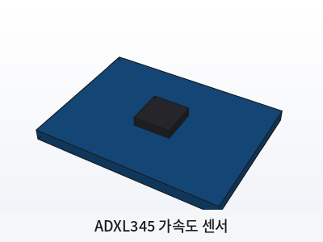 | [ADXL345 가속도 센서 GY-291 **납땜판**](https://ko.aliexpress.com/item/1005006674837364.html) ("용접 버전", 핀 납땜되어 나옴) | 1 | ₩6,500 | 9,970 | 무료 · 11/28~12/07 | 멈춘 각도를 읽어 CSI와 함께 넘긴다 |
| 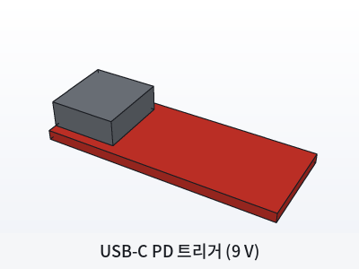 | [USB-C PD 트리거, 딥 스위치 + 나사 단자](https://ko.aliexpress.com/item/1005012175976383.html) (9 V로 맞춤) | 1 | ₩1,506 | 표시 없음 | 무료 · 12/03~12/08 | 받침 안에서 보조배터리의 9 V를 받는다 |
| 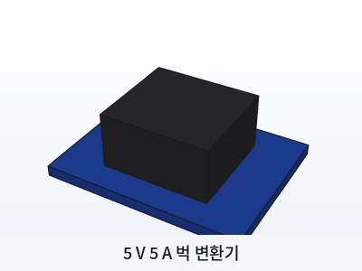 | [RCNUN 5 V 5 A 벅 변환기, 선 달림](https://ko.aliexpress.com/item/32326484181.html) (옵션 "12V-24V to 5V 5A", 입력 8~36 V) | 1 | ₩3,663 (신규 회원 ₩1,506) | 표시 없음 | 무료 · 12/02~12/08 | 머리 안에서 9 V를 5 V로 바꾼다 |
| 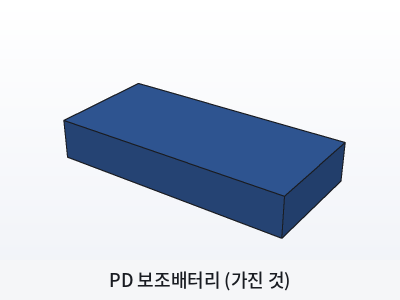 | PD 20,000 mAh 보조배터리 | 1 | 가진 것을 쓴다 | — | — | 전원(R2 · R8 계산에서 제외) |
| — | 기타(납땜 없이 잇기): PLA 필라멘트(약 0.95 kg, 가진 것), 듀폰 암–암 점퍼(10 · 15 cm) · Y 갈래 1개 · 암–나선 6가닥, 와고 221 레버 커넥터 5구 4개, XH2.54 2핀 한쪽 커넥터 선, 전해 콘덴서 100 µF 35 V, 실리콘선 22 AWG 빨강 · 검정 각 0.5 m, M3 나사 · 너트(나일론 10개, 강철 20개, 길이는 [조립 순서](https://github.com/DeteCam/receiver/blob/main/hw/조립_순서.md) 0.2절), M2 · M2.5 태핑 나사, 고무발 4개, 양면 폼테이프, 순간접착제, 짧은 USB-C ↔ USB-C(ㄱ자) · 마이크로 USB 케이블, 벽에 걸 때 레버식 흡착판 2개 | — | 약 ₩25,000~₩35,000 (추정) | — | 국내 택배 | 출력과 배선. 고리 둘레에는 금속 나사를 쓰지 않는다. 핀 단위 배선은 [배선표](https://github.com/DeteCam/receiver/blob/main/hw/배선표.md) |

- **확인한 값의 합: ₩448,065**(11-27 납땜 없는 판으로 바꾼 차이 +₩7,613 포함, 위 표에서 값과 배송비가 확인된 것, 예비 안테나 3개 · 어댑터 3개 포함, 1달러 1,350원). 여기에 기타 재료, Waveshare 배송비, DigiKey · element14 부가세(결제 화면에서 붙을 수 있음, 미확인)를 더하면 **1기 약 48~51만 원(추정)**이다. 목표 상한 70만 원(R2) 안이다.
- 표의 "표시 없음"은 판매 페이지에 재고 수량이 적혀 있지 않았다는 뜻이다(구매 버튼은 열려 있었다).

## 2. 이번 확인에서 바뀐 것

- **필름 안테나는 300 mm 케이블판으로 바꾼다.** 지금 배선(등뼈 배선: 케이블을 고리 면 안에서 뒤쪽으로 비스듬히 모아 고리 안쪽 뒤에서 내림)은 가장 긴 케이블이 258 mm라 250 mm판으로는 8 mm 모자란다(셈). 300 mm판이면 여유가 42 mm다. 같은 시리즈의 146153-0300은 DigiKey 재고가 0이고, **146153-9300**(같은 시리즈의 자동차 등급판, U.FL 호환 MHF1, 300 mm)은 재고 6,243개다. 9300판의 크기(35 × 9 mm)와 패턴이 0100판 문서와 같은지는 주문 전에 제품 도면으로 한 번 더 본다(추정: 같은 시리즈).
- **배송이 1월로 잡히는 상품은 뺐다.** 사용자 장바구니에 있는 RG316 낱개 점퍼(상품 4000586343422)는 배송 예정이 1/10~1/25다. 표의 5개 묶음(12/02~12/07)으로 바꾼다. MHF4–SMA 수 피그테일(1005005708869751)과 M.2 어댑터(1005013443330305)도 1월 도착이라 뺐다.
- 감쇠기는 **6 dB** 옵션이다(장바구니에는 20 dB · 30 dB가 들어 있다).
- SP16T 판매 페이지에서 새로 읽은 값: 기판 60 × 100 mm, 판매자 측정 삽입 손실 3 GHz 3.4 dB · 5 GHz 4.9 dB · 6 GHz 5.2 dB, 격리 3 GHz 48 dB · 5 GHz 46 dB, 구조는 2갈래 스위치 1개 + 8갈래 스위치 2개.

## 3. 사는 순서와 벤치 시험

1기분을 한 번에 사되, 받은 뒤에는 아래 순서로 확인한다. 앞 단계가 안 되면 뒤 단계 부품은 반품 기간 안에 판단한다.

| 순서 | 부품 | 확인할 것 | 통과 기준 |
|---|---|---|---|
| 1 | 호스트(CM4 + 캐리어 + M.2 어댑터) + AX210 | 부팅, `lspci`로 카드 인식(8086:2725), 드라이버 · 펌웨어 번호, `rfkill list` | 커널 6.12.75 이미지에서 CSI 드라이버가 올라옴 |
| 2 | (같음) | CSI 드라이버를 올린 채 CM4 내장 블루투스로 폰 연결 | 측정 중 연결이 유지되고 CSI를 방해하지 않음. 안 되면 Pico W |
| 3 | AX210 + 안테나 2개 | 2.4 · 5 GHz에서 시험 카메라 프레임의 두 단자 CSI | 초당 30개 이상, 두 단자 위상 차가 180° 뒤집힘을 빼고 1분 동안 5° 이내 |
| 4 | 분배기 + 감쇠기 | 두 단자에 세기 차를 0 · 3 · 6 · 10 dB로 주고 CSI 행 순서와 단자 대응 기록 | "센 쪽 = 기준 체인" 판정이 맞는 비율 확인 |
| 5 | 전원(보조배터리 → PD 9 V → 5 V 벅) | 시동, 대기 중 꺼짐 여부, 전류 | 점검 한 번 동안 끊기지 않음. 지속 시간을 기록 |
| 6 | SP16T | 칩 표기(흡수형인지), 5 V 전류와 헤더 3.3 V 핀, 제어선 입력 전류, 16포트 손실, 모두 끔(ALL-OFF) 격리, 전환 시간([SP16T 제어표](https://github.com/DeteCam/receiver/blob/main/hw/SP16T_제어표.md) 4절) | 반품 기간 안에 16포트 모두 확인 |
| 7 | 윌킨슨 2개 + 감쇠기 | 앵커 마진과 부호 복원(감쇠기 0 · 6 · 10 dB), 모두 끔 상태에서 체인 B ÷ 체인 A가 일정한지 | 부호 복원이 계산값(97%)과 비슷함 |
| 8 | 끄덕이기(웜기어 스텝 + TMC2209 + ADXL345) | 세 자세 반복 정밀도, 소리, 멈춘 뒤 처짐 | 1 m에서 거슬리는 소리 없음. 자세 오차가 계산에서 가정한 3° 안인지 기록 |

- 알리익스프레스 할인은 12월 3일 23시 59분까지다.
- 끄덕이기 구동 부품(모터 · 드라이버 · 가속도 센서)은 **1기분과 함께 산다**(2026-11-27 결정, [현재_방향.md](현재_방향.md) 8절).

## 4. 구매 전 확인표

확인 수준: **확인됨(문서)** · **확인됨(사례)** · **추정** · **미확인** ([AGENTS.md](AGENTS.md) 6장). 번호 U는 [현재_방향.md](현재_방향.md) 4절의 확인 항목이다.

| 부품 | 후보 | 확인할 것 | 지금 상태 | 출처 |
|---|---|---|---|---|
| 무선랜 카드 | Intel AX210NGW (M.2 2230, PCIe) | 남의 프레임에서 두 수신 단자 CSI(2.4 · 5 GHz), 두 단자 위상 안정성 | 확인됨(문서): 드라이버가 프레임마다 CSI와 보낸 기기 주소를 기록. 확인됨(사례): 두 단자 사이에 패킷마다 180° 뒤집힘이 생길 수 있음(앵커로 되돌림). 미확인: 시험 카메라 프레임, 위상 안정성(U5). ACK · CTS · 11b 비콘은 CSI가 안 나옴(확인됨(사례)) | FeitCSI 문서, VesperCSI 논문, PicoScenes 이슈, AX200 위상 오프셋 논문 |
| 무선랜 카드 주의 | AX201 · AX211 · BE201 | 사면 안 됨 | 확인됨(문서): 노트북 전용(CNVio2) 규격 | Intel 사양 |
| 호스트 | Raspberry Pi CM4(CM4102000, 무선 포함) + Waveshare CM4-IO-BASE-A(V3.1 이상) + M.2 M-key → A-key 어댑터 | AX210 인식, CSI 드라이버 빌드, 내장 블루투스, M.2 전원 | 확인됨(사례): CM4 + AX210 CSI 기록. 커널 6.18 이미지는 드라이버 빌드 실패라 6.12.75 이미지로 고정(U6). 확인됨(문서): 캐리어 회로도에서 M.2 3.3 V를 MP1658(3 A 강압 칩)이 따로 만든다. 미확인: 드라이버와 내장 블루투스 동시 사용(U7) | VesperCSI 논문, FeitCSI GitHub 이슈, Waveshare 위키 · 회로도 |
| 호스트 대안 | Raspberry Pi 5 + M.2 확장판 | 위와 같음 | 추정. CM4가 안 될 때만 | Raspberry Pi 문서 |
| RF 스위치 | SP16T Core Board(STM32판 아님) | 2.4 · 5 GHz 손실 · 격리 · 포트 위상, 제어 전압, 전환 시간, 5 V 전류, 꺼진 포트가 50 Ω으로 끝나는지 | 확인됨(문서, 판매 사진 · 판매자 측정 화면): 진리표(16채널 + 모두 끔), 제어 핀 9개, 5 V 전원 단자, 손실 3 GHz 3.4 dB · 5 GHz 4.9 dB, 격리 3 GHz 48 dB · 5 GHz 46 dB, 기판 60 × 100 mm. 추정: pSemi PE42582 계열(흡수형) 8갈래 칩 2개 + 앞단, 로직 최대 3.6 V. 미확인(U2 · U18): 칩 이름, 5 V 전류, 전환 시간, 꺼진 포트 종단 → 도착 시험 | 판매 페이지(2026-11-26), [SP16T 제어표](https://github.com/DeteCam/receiver/blob/main/hw/SP16T_제어표.md) |
| 안테나 | Molex 146153-9300 필름(U.FL 호환, 케이블 300 mm) 17개 + 예비 3개 | 붙이는 면, 금속 거리, 케이블 길이 · 배선, 24 mm 간격에서의 결합, 9300판이 0100판과 같은 크기 · 패턴인지 | 확인됨(문서, 0100판): 평형 다이폴형 2.4 · 5 · 6 GHz, 35 × 9 × 0.1 mm, 케이블이 긴 변 가운데에서 옆으로 나옴, 매끈한 플라스틱에 부착 · 금속면 금지. 계산값: 배선에 따라 방향 오차가 크게 바뀐다. 지금 배선(등뼈 배선)이면 케이블 없는 모델 대비 한 자리 방향 2.4 GHz +0.5~1.8%, 5 GHz −3.7~+1.3%(U16). 추정: 9300판은 같은 시리즈의 자동차 등급판. 미확인: 16개를 고리에 붙였을 때의 패턴 · 결합(U3) | Molex 응용 사양 AS-1461530100, DigiKey 상품 정보, [안테나 부착과 배선](https://github.com/DeteCam/receiver/blob/main/hw/안테나_부착과_배선.md) |
| 안테나 → 스위치 | SMA 수–U.FL 수 어댑터 17개 | 스위치 쪽이 일반 SMA인지(RP-SMA 아님) | 확인됨(문서, 판매 글): SP16T는 SMA 암 | 판매 페이지 |
| 앵커 | 윌킨슨 2분배기 2개 | 2.4 · 5 GHz 삽입 손실 · 위상 균형 | 손실값은 판매자 화면 · 후기 1건(U8) | 판매 페이지 |
| 감쇠기 | SMA 6 dB 2개(스위치 공통 포트 뒤 1, 체인 B 입력 1) | 6 GHz까지 값이 맞는지 | 계산으로 자리와 값을 정함. 실물 확인은 U8 · U13 | 판매 페이지, [현재_방향.md](현재_방향.md) 1절 |
| AX210 연결 | MHF4 – SMA 암 피그테일 2개 + SMA 수–수 점퍼 | 커넥터 규격(MHF4, U.FL 아님 / SMA, RP-SMA 아님) | 확인됨(문서, 판매 옵션): "SMA-K Female" | Intel 사양, 판매 페이지 |
| 스위치 제어 | Raspberry Pi Pico(대안 Pico W, CM4 GPIO 직결) | 스위치 제어선 전압(3.3 V), 선 수 | 확인됨(문서, 판매 사진): 제어선 9개. 3.3 V 로직으로 9개를 한 번에 씀. 헤더 3.3 V 핀이 입력인지 출력인지는 도착 시험 | Raspberry Pi 문서, 판매 사진 |
| 끄덕이기 | 42각 웜기어 스텝 + TMC2209 + ADXL345 | 소리, 멈춘 뒤 처짐, 자세 측정 | 조건은 문서로 정리(U9). 실물 확인 필요 | 판매 페이지, TMC2209 데이터시트 |
| 전원 | PD 보조배터리 + PD 트리거 9 V + 5 V 5 A 벅 | 약한 전류에서 자동 꺼짐, 시동 | 대기 중에도 CM4를 켜 두는 것으로 대응(U9) | 판매 페이지 |

## 5. 함정

- **RP-SMA와 SMA**: 무선랜용 안테나 · 케이블은 RP-SMA가 많다. 스위치 · 분배기 · 감쇠기는 일반 SMA다. 옵션 이름에서 "RP"가 붙지 않은 것을 고른다.
- **MHF4와 U.FL**: AX210 단자는 MHF4, 필름 안테나는 U.FL(MHF1)이다. 서로 맞지 않는다.
- **M.2 M-key 슬롯에는 USB가 없다**: AX210의 블루투스는 쓸 수 없다. 폰 연결은 CM4 내장 블루투스로 한다.
- **CM4는 무선 포함 모델**(CM4102000)을 산다. 캐리어는 V3.1 이상이다.
- **SP16T는 Core Board**를 산다. 이름이 비슷한 STM32 내장판은 다른 상품이다.
- **같은 안테나 17개**: 고리의 대칭이 보정의 전제다. 같은 판매자 · 같은 제품으로 한 번에 산다.
- **감쇠기 2개는 자리가 다르다**: 하나는 스위치 공통 포트 뒤(앵커 마진), 하나는 AX210 체인 B 단자 앞(체인 가르기)이다.
- **케이블은 300 mm판**: 가장 긴 케이블이 258 mm(여유 42 mm, 셈)다. 250 mm판은 8 mm 모자라 쓰지 않는다. SP16T는 8포트 변을 뒤쪽(케이블 묶음이 들어오는 쪽)으로 두고, 긴 케이블을 가까운 포트에 짝짓는다([조립 순서](https://github.com/DeteCam/receiver/blob/main/hw/조립_순서.md) 4절 표). 남는 길이는 상자 안에서 감아 둔다.
- **알리익스프레스 이코노미 배송은 1월 도착이 섞여 있다.** 상품 페이지의 배송 예정일을 꼭 본다.
